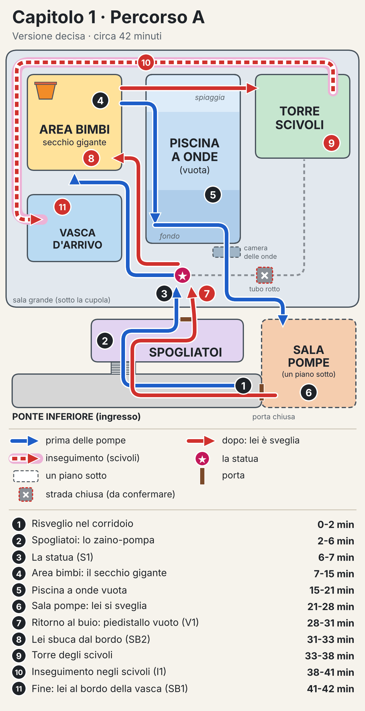
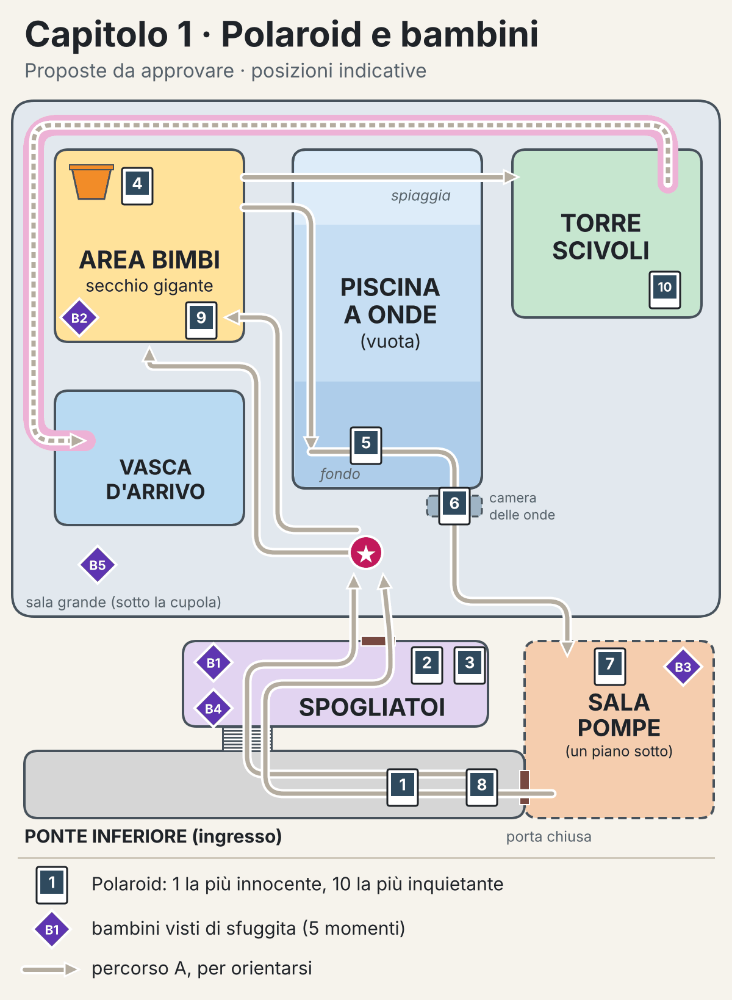

# Capitolo 1 · Il livello

> Versione decisa, con le scelte dell'utente del 14 ottobre 2026 (riassunte anche nel [GDD](../GDD.md)). Le proposte di partenza restano in [proposte/livello/capitolo1.md](../proposte/livello/capitolo1.md). In fondo ci sono le **proposte da approvare** e due **dettagli da confermare**.

## Riassunto

- Percorso **A, lineare**: una zona dopo l'altra, circa 42 minuti.
- Ti svegli per terra nel corridoio. Nello stanzino dei bagnini trovi lo zaino-pompa, che **aspira e spara** l'acqua.
- Al 6° minuto vedi la statua da vicino; quando parte la sigla, la campana pulsa per un attimo. Poi area bimbi, piscina vuota e sala pompe, dove lei si sveglia.
- Al ritorno, al buio, il piedistallo è vuoto. Poco dopo lei sbuca dal bordo di una vasca dell'area bimbi.
- Finale: scivolata nei tubi con lei dietro. La grata la ferma, ma nell'ultima immagine è aggrappata al bordo della vasca d'arrivo.
- Prima dell'inseguimento non ti dà la caccia: ti prende solo se te la vai a cercare.
- 10 Polaroid rivelano una parte della lore. Checkpoint invisibili e frequenti. La scena della morte si può saltare.
- **Da approvare:** dove stanno e cosa mostrano le 10 Polaroid, e 5 momenti in cui si vedono i bambini.

## La mappa

- Blu: prima delle pompe. Rosso: dopo, quando lei è sveglia.
- Tratteggio rosso sulla fascia rosa: l'inseguimento negli scivoli.
- Riquadro grigio tratteggiato: un piano sotto. Croce col bordo rosso: il tubo rotto, da confermare.

## Le tappe

1. Risveglio nel corridoio del ponte inferiore · 0-2
2. Spogliatoi: lo zaino-pompa · 2-6
3. La statua · 6-7
4. Area bimbi: il secchio gigante · 7-15
5. Piscina a onde vuota · 15-21
6. Sala pompe: lei si sveglia · 21-28
7. Ritorno al buio: il piedistallo vuoto · 28-31
8. Area bimbi: lei sbuca dal bordo · 31-33
9. Torre degli scivoli · 33-38
10. Inseguimento negli scivoli · 38-41
11. Fine: lei al bordo della vasca d'arrivo · 41-42

## Le regole del capitolo

### Lo zaino-pompa

- **Aspira** l'acqua e la **spara**. Il serbatoio si vede sullo zaino: il livello sale e scende.
- Si ricarica aspirando da pozze e vasche. Nell'acqua che scorre, come negli scivoli, si ricarica da solo.
- Il getto attiva pulsanti e turbine a distanza, riempie e svuota le vasche, dà la spinta per saltare e respinge lei per un attimo.
- Una cosa nuova per volta: aspirare e sparare negli spogliatoi; riempire e svuotare nell'area bimbi e in piscina; la spinta sulla torre; respingere lei nell'inseguimento.
- L'aspetto dello zaino è ancora da decidere.

### Lei

- **Prima delle pompe** è una statua: non si muove e non fa niente.
- **Dalle pompe all'inseguimento** si fa vedere, ma non ti dà la caccia. Ti prende solo se te la vai a cercare: se le arrivi troppo vicino o la tocchi.
- **Nell'inseguimento** ti segue fluttuando, veloce, con le braccia tese. Non corre mai.
- Il colore della luce della campana è ancora da decidere (nei concept è rosa).

### Morte e checkpoint

- Se lei ti prende: **scena intera**. La pelle del viso si strappa sotto l'occhio e si apre la fauce con i denti da squalo. La scena **si può saltare**.
- Se cadi, dalla torre o da un tubo rotto: nero e ripartenza, senza scena.
- Riparti in pochi secondi dall'ultimo checkpoint.
- **Checkpoint invisibili e frequenti**: all'ingresso di ogni zona, dopo ogni passo di un enigma, prima delle scene importanti, prima dell'inseguimento e due volte durante.

### La lore nascosta

- La crociera è naufragata. Un gruppo di bambini a bordo è sopravvissuto, da solo.
- Un mostro marino ha preso possesso della bambola-mascotte e negli anni li ha cresciuti e allevati.
- Il gioco non la racconta. Si intuisce solo in parte dalle **10 Polaroid** da collezione, che insieme non rivelano tutto. Niente testi, diari o voci che spiegano.

### I bambini

- Sono i bambini cresciuti da lei. Nel capitolo 1 si vedono **solo di sfuggita**.
- Sempre vestiti, niente nudità, niente gore, niente violenza sui bambini. **Il giocatore non li ferisce.**
- Il loro aspetto qui non è descritto: è ancora da decidere. Questo documento parla solo di momenti e comportamenti.

## Le zone, in ordine

### 1. Ponte inferiore · 0-2 min

- Ti svegli per terra nel corridoio, senza spiegazioni. La nave scricchiola, la tempesta batte sullo scafo, ci sono solo luci d'emergenza rosse.
- Un grande cartellone colorato mostra la mascotte disegnata, sorridente: è la prima volta che la vedi.
- Accanto c'è la porta della sala pompe, chiusa. La riaprirai da dentro.
- **Zaino:** non ce l'hai ancora.
- **Tensione:** bassa. Alle tue spalle una porta tagliafuoco si chiude da sola: non si torna indietro.

### 2. Spogliatoi · 2-6 min

- Armadietti, panche, docce e il corridoio con la vasca lava-piedi. Braccioli e ciabatte dimenticati.
- Nello **stanzino dei bagnini** trovi lo zaino-pompa, con il serbatoio vuoto.
- **Zaino (si impara qui):**
  - aspiri l'acqua dalla vasca lava-piedi e il serbatoio si riempie;
  - col getto colpisci il pulsante del tornello, fuori portata dietro un vetro rotto;
  - tieni il getto su una piccola turbina: la saracinesca sale piano e resta su.
- **Tensione:** le docce si aprono da sole, tutte insieme, poi si chiudono. Un armadietto sbatte: dentro c'è solo un salvagente colorato. Falso spavento.

### 3. La statua · 6-7 min

- Esci dagli spogliatoi e una lampada su un palo si accende, ronzando. Davanti a te, sul piedistallo, c'è lei: immobile, alta sopra di te, le mani giunte sul petto, il grande occhio aperto.
- È come nel concept [medusa_statua.jpg](../concept/medusa_statua.jpg): lucida, sporca, con i canali della campana appena accesi.
- Puoi girarle intorno quanto vuoi. Non succede niente.
- Sul piedistallo c'è un grosso pulsante per i bambini: se lo colpisci col getto parte la sigla dell'acquapark, allegra e un po' stonata.
- Mentre suona la sigla, i canali della campana pulsano a tempo, per un attimo. Poi tornano fermi.

### 4. Area bimbi · 7-15 min

- La zona più colorata: giocattoli saturi dello stile B e pastelli anni '90 dello stile C. Struttura di gioco a più piani, cannoncini ad acqua, funghi-fontana, vasche basse e, in cima, il secchio gigante.
- **Zaino: "il secchio"**
  - Le scale sono crollate. Col getto fai girare una ruota a pale: si abbassa un ponticello.
  - Aspiri l'acqua dalla vasca d'arrivo lì accanto e la spari in una vasca bassa: un grosso gonfiabile a forma di balena sale con l'acqua e ti fa da gradino.
  - In cima tieni il getto sulla turbina che pesca l'acqua dalla vasca e la manda nel secchio. Il secchio si riempie, si inclina e si rovescia.
  - L'ondata fa girare una grande ruota che apre il cancello della piscina a onde.
- **Tensione:** il secchio che si rovescia fa un rumore assordante. L'acqua bagna un quadro elettrico: scintille, e dagli altoparlanti parte la sigla, rallentata e storta. Si spegne a metà.

### 5. Piscina a onde vuota · 15-21 min

- La grande vasca sotto la cupola, vuota: piastrelle scrostate, giocattoli sul fondo, una rosa dei venti a mosaico. Sopra, la tempesta e i lampi.
- Entri dalla spiaggia, la parte bassa in pendenza. Nella parte profonda è rimasta solo una pozza d'acqua torbida. La piscina resta vuota.
- **Zaino: "svuota la pozza"**
  - Sotto la pozza c'è il portello della camera delle onde, il tunnel che porta alla sala pompe.
  - Lo scarico è bloccato: la sua turbina, in alto sul muro, è incastrata da un gonfiabile. Lo fai cadere col getto.
  - Tieni il getto sulla turbina. Quando il serbatoio si svuota, lo ricarichi aspirando dalla pozza stessa.
  - L'acqua scende davvero, con il gorgo, e sul fondo ricompaiono il portello e i giocattoli. Colpisci il pulsante del portello e scendi.
- **Tensione:** la statua è sul bordo, proprio sopra la parte profonda. Mentre lavori sul fondo, lei è sopra di te e non si muove mai. Lo scarico fa un gorgoglio lungo che sembra un respiro. Nella camera delle onde le pale cigolano e dalle bocchette arriva aria, a soffi.

### 6. Sala pompe · 21-28 min

- Un piano sotto, tutta industriale: tubi, ruggine, vapore, manometri, grandi filtri tondi, una vasca di raccolta piena d'acqua nera.
- Un vecchio monitor a tubo mostra la sala grande ripresa da una telecamera: la statua è ancora lì.
- **Zaino: "riaccendi le pompe"**
  - Tre pompe, ognuna con la sua turbina d'avviamento. Le fai girare col getto nell'ordine giusto, indicato da uno schema a colori sul muro (niente da leggere).
  - L'acqua per il serbatoio la aspiri dalla vasca di raccolta.
  - Per ultima la leva grande, in alto dietro una grata: la colpisci col getto.
- **Lei si sveglia:**
  - le pompe ruggiscono e l'acqua corre nei tubi; tutte le luci dell'acquapark si accendono per un secondo e la sigla parte a tutto volume;
  - poi la corrente salta: buio, solo le luci rosse d'emergenza;
  - il monitor mostra solo neve; sotto il rombo delle pompe, lontano, un rumore lungo di plastica che si piega, poi un tonfo nell'acqua;
  - non vedi niente: capisci solo che qualcosa è cambiato.
- **Come esci:** le paratie della camera delle onde si abbassano. Resta la porta del ponte inferiore, che da dentro si apre col maniglione.

### 7. Ritorno al buio: il piedistallo vuoto · 28-31 min

- Ripassi dal ponte inferiore e dagli spogliatoi, al buio. Le docce scorrono senza fermarsi e il vapore copre tutto.
- Esci dalla stessa porta di prima: la stessa inquadratura della statua, ma al buio.
- **Il piedistallo è vuoto.** Sopra c'è una pozza d'acqua che ancora gocciola dai bordi.
- Una scia di gocce sul pavimento si allontana nel buio, verso l'area bimbi.
- Niente musica, niente mostri. Solo le gocce e la tempesta. E devi andare avanti lo stesso.

### 8. Area bimbi: lei sbuca dal bordo · 31-33 min

È la scena di [medusa_sbircia.jpg](../concept/medusa_sbircia.jpg).

- Quando sono ripartite le pompe, tra il piedistallo e la torre è scoppiato un tubo: un getto d'acqua violento chiude la strada diretta (**da confermare**).
- Segui la scia di gocce fino all'area bimbi. Le vasche basse si stanno riempiendo: il livello sale davanti a te.
- A pochi metri lei sbuca dal bordo di una vasca: le mani sulle piastrelle, l'occhio fisso su di te.
  - **Come è fatto (15 ottobre).** Le vasche basse hanno solo 28 cm d'acqua e lei è alta 4,5 m. Per questo lungo il bordo della prima vasca a scacchi c'è lo scarico di compensazione rotto: una fossa profonda circa 3 m, con la griglia divelta.
  - Da lì risale l'acqua che riempie le vasche, ed è da lì che sbuca lei. Quando scivola sotto, la sua luce se ne va lungo il condotto in fondo alla fossa.
- Se resti lontano, dopo un po' scivola sotto e la sua luce si allontana sott'acqua, come in [medusa_sottacqua.jpg](../concept/medusa_sottacqua.jpg).
- Se le arrivi troppo vicino, o la tocchi, ti prende.
- Poi attraversi la spiaggia della piscina vuota, fino alla torre. Niente ripari.

### 9. Torre degli scivoli · 33-38 min

- Un'impalcatura altissima di tubi colorati, scale e piattaforme. In cima, le partenze degli scivoli. Con le pompe accese l'acqua scorre.
- **Zaino: "la salita"**
  - Le scale sono interrotte: spari il getto verso il basso e la spinta ti porta alla piattaforma sopra. La spinta consuma tanta acqua: ricarichi dai tubi che perdono.
  - Un montacarichi di servizio sale finché tieni il getto sulla sua ruota a pale: ci stai sopra e spari in basso.
  - I cancelli delle partenze si aprono solo con l'acqua che scorre.
- **Tensione:** dall'alto vedi la sala al buio e il piedistallo vuoto, piccolo, laggiù. Poi una luce in basso, nel pozzo centrale della torre. Sale, prima piano, poi più veloce: è lei che fluttua verso di te.

### 10. Inseguimento negli scivoli · 38-41 min

- **Cosa fai:**
  - l'unica via è buttarti nel tubo più grande;
  - scivoli in avanti da solo: ti sposti a destra e a sinistra e ti abbassi nei tratti schiacciati;
  - ai bivi colpisci col getto la paratia giusta; la strada sbagliata finisce contro una grata, e lei ti raggiunge;
  - in un tratto il tubo è spaccato: voli fuori e usi la spinta per arrivare al pezzo dopo;
  - il serbatoio si ricarica da solo, perché nel tubo l'acqua scorre.
- **Lei:** ti insegue dentro il tubo, fluttuando, con le braccia tese. La sua luce, dietro di te, ti dice quanto è vicina. Quando la luce riempie lo schermo, ti giri e le spari il getto: si ferma un attimo e tu guadagni metri. La prima volta un'icona ti suggerisce di farlo.
- **Come ti salvi:** lo scivolo ti sputa nella vasca d'arrivo. Esci dall'acqua e colpisci il pulsante della grata di sicurezza: la grata cala sulla bocca dello scivolo un attimo prima che lei esca.

### 11. Fine del capitolo · 41-42 min

- Lei resta dietro la grata. L'occhio ti fissa, i tentacoli passano tra le sbarre. Poi si ritira nel buio del tubo e la sua luce si allontana.
- Silenzio, solo la tempesta. Ti avvii verso l'uscita.
- Alle tue spalle, uno sciabordio. Ti giri: lei è aggrappata al bordo della vasca d'arrivo, l'occhio fisso su di te.
- Nero. Fine del capitolo 1. Non si spiega niente: il mistero resta.

## Proposte da approvare

### 1. Le 10 Polaroid

Dalla più innocente alla più inquietante, lungo il capitolo. "Tappa" è il numero sulla mappa del percorso. Insieme fanno intuire la lore, a pezzi: non mostrano mai il mostro che prende la bambola, né spiegano perché.

1. **P1 · Tappa 1**, a terra vicino a dove ti svegli. Una famiglia sorridente all'ingresso dell'acquapark, sotto il cartellone della mascotte.
2. **P2 · Tappa 2**, in un armadietto. Bambini in costume in fila per salutare la statua della mascotte, nuova, con un fiocco sul piedistallo.
3. **P3 · Tappa 2**, sulla bacheca dello stanzino dei bagnini. Il gruppo del corso di nuoto in posa con i bagnini: sono i bambini che tornano nelle foto dopo.
4. **P4 · Tappa 4**, in cima alla struttura di gioco, infilata sotto la tettoia accanto al secchio. Notte di tempesta: lo stesso gruppo, con i giubbotti di salvataggio, stretto in cima alla struttura di gioco. Intorno solo acqua e luci rosse.
5. **P5 · Tappa 5**, sul fondo della piscina, tra i giocattoli che riaffiorano quando svuoti la pozza. La piscina vuota diventata un accampamento: materassini, coperte, scatolette. Nessun adulto.
6. **P6 · Tappa 5**, nella camera delle onde. Un muro coperto di tacche per contare i giorni, tantissime. Accanto, un disegno della mascotte con tanti cuori.
7. **P7 · Tappa 6**, nella sala pompe, accanto al monitor. Il piedistallo è vuoto: la statua è in acqua, in mezzo ai bambini addormentati, con le braccia intorno a loro.
8. **P8 · Tappa 7**, sul ponte inferiore, proprio dove ti eri svegliato: prima non c'era. Lei che dà da mangiare ai bambini, pesce crudo, uno alla volta, come si fa con i cuccioli.
9. **P9 · Tappa 8**, accanto alle vasche basse. I bambini in fila nell'acqua fino al petto, immobili, tutti girati verso di lei che brilla al centro. Nessuno guarda l'obiettivo.
10. **P10 · Tappa 9**, in cima alla torre: è quella sparita negli spogliatoi (B4). Una foto sott'acqua, verde e sfocata: sotto la chiglia della nave, una forma scura enorme, piena di tentacoli. In alto, piccola, la luce della campana.

### 2. I bambini, visti di sfuggita

Cinque momenti in 42 minuti, di pochi secondi ciascuno. Il primo si può anche non notare.

- **Mai un confronto diretto:** si vedono lontano, di spalle, in un lampo o su un monitor.
- **Non si possono raggiungere:** quando arrivi sono già spariti. In questo capitolo non attaccano mai.

1. **B1 · Tappa 2, spogliatoi.** Quando le docce si chiudono, sul pavimento restano impronte bagnate che vanno verso una grata di aerazione. La grata oscilla ancora. *Cosa fanno:* giocavano con le docce e sono scappati.
2. **B2 · Tappa 4, area bimbi.** Mentre sali sulla struttura, dagli scarichi delle vasche arrivano risatine che rimbombano nei tubi. Se ti fermi ad ascoltare, silenzio. *Cosa fanno:* ti seguono dentro i tubi.
3. **B3 · Tappa 6, sala pompe**, prima di riaccendere le pompe. Sul monitor una sagoma passa davanti alla statua, le appoggia una mano sul piedistallo e se ne va. Quando guardi di nuovo, c'è solo la statua. *Cosa fanno:* vanno a trovarla.
4. **B4 · Tappa 7, spogliatoi al buio.** Su una panca c'è una Polaroid. Il neon sfarfalla: la panca è vuota, e impronte bagnate si allontanano. La ritrovi in cima alla torre, appoggiata con cura (P10). *Cosa fanno:* la spostano, come in un gioco.
5. **B5 · Tappa 9, torre.** Durante la salita, un lampo illumina la balconata dall'altra parte della sala: una fila di sagome immobili, tutte girate verso di te. Al lampo dopo non c'è nessuno. Poco dopo, la luce di lei sale nel pozzo. *Cosa fanno:* guardano, come se sapessero cosa sta per succedere.

## Dettagli da confermare

1. **Il tubo rotto** tra il piedistallo e la torre (tappa 8): serve a portarti verso l'area bimbi invece che dritto alla torre. Proposta: tenerlo.
2. **Da dove si aspira l'acqua negli enigmi**: vasca lava-piedi, pozza della piscina, vasca d'arrivo, vasca di raccolta della sala pompe, tubi che perdono sulla torre. Proposta: tenerli così.

---

Le due mappe si rigenerano con `genera_mappa_capitolo1.py` (serve matplotlib).
