# L'enigma dei giocattoli nella piscina a onde (consegna del 29 ottobre)

È l'idea A scelta dall'utente il 28 ottobre (GDD, scelte del 28 ottobre), "I giocattoli al loro posto", con la sua nota: "ma facciamo che puoi spingere i giocattoli anche una volta che hai svuotato la piscina".
- Il lavoro sta sul branch `lavoro/enigma-giocattoli`, partito da `lavoro/godot` efc7352f.
- **Non va unito prima che l'utente l'abbia visto.**

## Come si gioca

Nella parte profonda della piscina a onde ci sono quattro elementi:
- **sul fondo, attorno alla botola, tre cerchi di mosaico** larghi 1 m: giallo, rosso e blu. Sono piatti che sporgono di 3 cm e scendono col peso: la serratura della botola;
- **nella pozza, tre giocattoli grandi** di gomma, mezzi pieni d'acqua, che galleggiano: la paperella gialla, il pallone rosso e la balena blu;
- **sul muro ovest della parte profonda il disegno a pastello dei bambini**, che mostra la piscina dall'alto con ogni giocattolo nel suo cerchio. Solo disegno, senza scritte;
- **le medusine luminose**, che nuotano come prima.

I passi:
1. **Si spingono i giocattoli col getto.**
   - Colpito direttamente, un giocattolo va dove va il getto.
   - L'acqua colpita vicino a lui lo porta con sé, e un muro colpito vicino lo respinge via dal muro.
   - Più sei vicino, più spinge.
   - Vicino al suo cerchio, un giocattolo che va piano ci scivola dentro da solo: non serve la precisione.
2. **Galleggiando sopra il suo cerchio** lo accende appena: il bordo di piastrelle fosforescenti.
3. **Si svuota la piscina come prima**, con 4 zainate.
4. **I giocattoli calano con l'acqua e si posano.** Chi è sul suo cerchio lo fa scendere con un tonfo: il bordo si accende tutto e il giocattolo resta lì.
5. **Scesi tutti e tre**, dagli scarichi arriva un risucchio lungo e il lampeggiante del pulsante della botola passa da giallo a verde. Colpito col getto, la botola si apre come prima.

**L'ordine è libero.** Si può anche svuotare prima e poi spingere i giocattoli sul fondo asciutto.
- Sul fondo vanno un po' più piano, ma non molto: strisciano sulle piastrelle.
- Ogni piatto scende appena il suo giocattolo ci arriva.
- Sul fondo i gonfiabili già sparsi sono ostacoli da girare.

**Se sbagli** non succede niente di grave:
- a piscina vuota coi giocattoli fuori posto, il lampeggiante resta giallo e il pulsante non si preme;
- i giocattoli si spingono anche sul fondo, quindi non c'è niente da rifare da capo.

**Durata**: 3-5 minuti.
- Il disegno: circa un minuto.
- I tre giocattoli: 1-2 minuti sull'acqua, un po' di più sul fondo.
- Lo svuotamento: 30 secondi, come prima.

## Dove sono le cose

Coordinate del mondo della sala. La botola è in x 0, z 2.0; la parte profonda va da x -7 a 7 e da z -1 a 5.

| | Cerchio | Giocattolo all'inizio |
|---|---|---|
| Paperella, giallo | (-3.9, 3.3) | (0.3, 2.5), sopra la botola |
| Pallone, rosso | (3.9, 3.3) | (4.4, -0.6) |
| Balena, blu | (-3.9, -0.1) | (-0.2, -0.8) |

Il disegno è sul muro ovest (x -6.97), all'altezza di z -0.2, fra 0,35 e 1,25 m sotto il bordo, sopra il pelo dell'acqua.

Cosa è stato tenuto libero, e come:
- **i cerchi** stanno sul fondo piano fuori dalla conca della botola, lontano dalla P5, dalle scalette, dalla ripartenza del checkpoint e dai gonfiabili;
- **i giocattoli appoggiati sul fondo** non vanno sulla P5, sulla ripartenza e sui gonfiabili: ne scivolano giù;
- **galleggiando** ci passano sopra.

**Dove i giocattoli non si incastrano più** (collaudo di ambienti-2 del 29 ottobre, su 519e34f6). C'erano tre posti dove un giocattolo restava bloccato, e con lui l'enigma.
1. **Contro i muri e negli angoli.** I giocattoli arrivavano a 40 cm dai muri: lì il giocatore non può mettersi dietro per spingerli via. Ora restano a circa un metro (x da -5,9 a 5,9, z da -3,5 a 3,95). Le scalette restano fuori.
2. **Sotto la scaletta ovest.** Il posto libero della scaletta li rispingeva contro il muro, e il getto che cadeva sul fondo davanti al muro ce li rimandava. Ora la scaletta è fuori dall'area. L'acqua e il fondo colpiti non spingono più un giocattolo verso il bordo, se ci è già contro.
3. **Sopra un gonfiabile.** Spinto a lungo, il pallone entrava 20 cm nella ciambella e restava sospeso sopra. Ora:
   - i gonfiabili hanno la loro misura vera: i tubi diventano una fila di cerchi lungo l'asse;
   - chi arriva da fuori non ci entra più di 1 cm;
   - un giocattolo spostato da fermo si riassesta sul fondo e non resta più per aria;
   - posato sopra un gonfiabile dall'acqua che cala, ne scivola giù.

`test_enigma_giocattoli` prova anche questi casi:
- da ogni angolo e da sotto le due scalette, a piscina vuota e piena, si riporta il giocattolo al suo cerchio col getto;
- il pallone spinto 4 s contro ogni gonfiabile non ci entra e non ci sale;
- la paperella posata sulla ciambella calando l'acqua ne scivola giù.

In locale: test_enigma_giocattoli 63/63, test_sala 105/105, test_tappe56 100/100.

## I gonfiabili d'arredo della parte profonda

Perché l'enigma si legga bene, nella parte profonda restano solo i tre giocattoli (richiesta del coordinatore del 28 ottobre). Le due paperelle giganti e i quattro palloni da spiaggia, che erano sparsi sul fondo, sono spostati sulla spiaggia della piscina, dove ci sono già il delfino sgonfio, una ciambella e altre paperelle: lì li ha portati l'onda.
- Le paperelle hanno il fondo piatto e stanno sulla pendenza della spiaggia, inclinate come lei.
- I palloni sono rotolati giù per la spiaggia fino a fermarsi contro qualcosa: due contro le paperelle spostate, uno contro il delfino sgonfio, uno contro la paperella in cima alla spiaggia. Il punto l'ha trovato il motore, lanciando una sfera giù per la pendenza (`tests/collaudo/posa_oggetti_piscina.gd`).
- Sul fondo restano le due ciambelle, il salvagente e i tubi galleggianti: non si confondono coi giocattoli, e nell'enigma sono ostacoli da girare.
- Gli spostamenti sono nella scena della sala, sui nodi di `sala_oggetti.glb`; il GLB non cambia.

Prima e dopo, dall'alto della parte profonda, a piscina vuota (scatti dal motore, stesso punto):

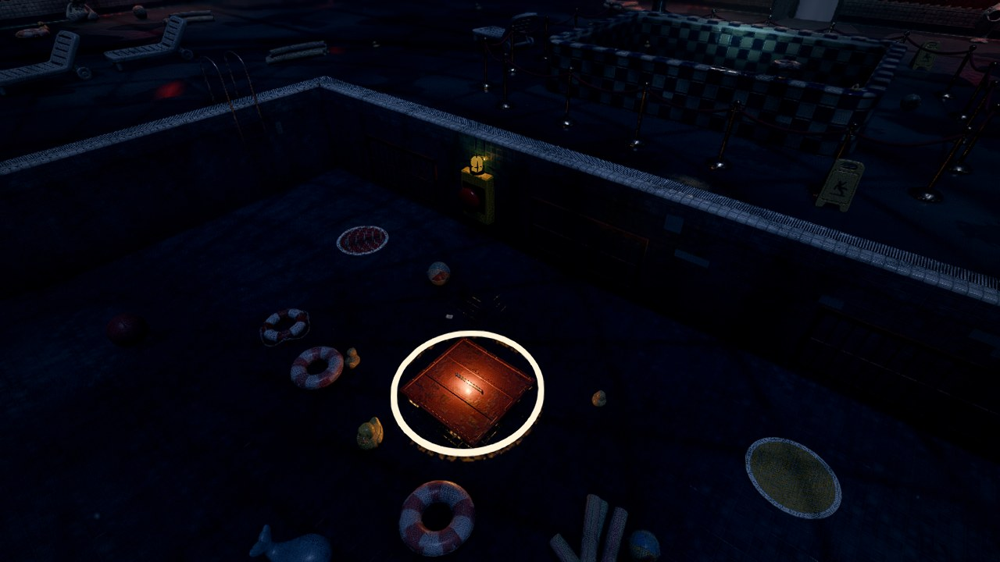
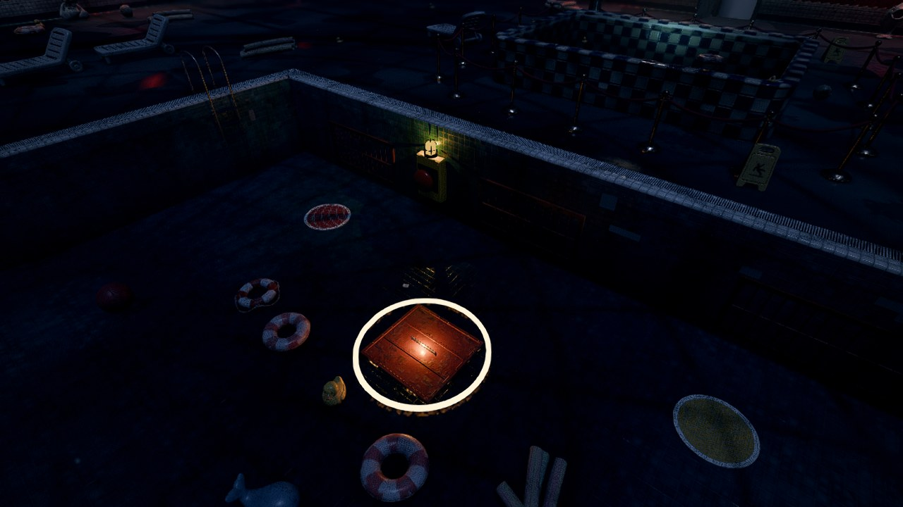

Sulla spiaggia, dove sono finiti:

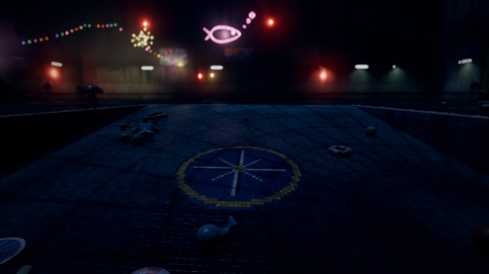

## Scatti e video

**Il video**: [giocattoli_video.mp4](giocattoli_video.mp4) (51 s, H.264, 10 MB). È ripreso dal motore, dagli occhi del giocatore, nella sala vera col preset medio. Per la memoria della macchina di prova sono tolte le zone lontane che dalla piscina non si vedono.

È un montaggio dei momenti chiave, con tagli in nero di mezzo secondo:
1. il disegno sul muro ovest, guardato dall'acqua della parte profonda;
2. la spinta sull'acqua: il pallone rosso fino al suo cerchio;
3. lo svuotamento dal bordo sud: la paperella cala con l'acqua, si posa sul cerchio giallo e il bordo si accende; poi lo sguardo va al cerchio rosso;
4. la spinta sul fondo vuoto: la balena strisciata fino al cerchio blu;
5. il lampeggiante del pulsante della botola diventato verde;
6. il getto sul pulsante e la botola che si apre.

Scorciatoie del montaggio, che nel gioco non ci sono:
- la paperella è messa al suo cerchio durante un taglio;
- dello svuotamento si vede solo l'ultima parte, accorciata a 5 secondi;
- prima della spinta sul fondo lo zaino è riempito durante il taglio.

Gli scatti, presi dal video:

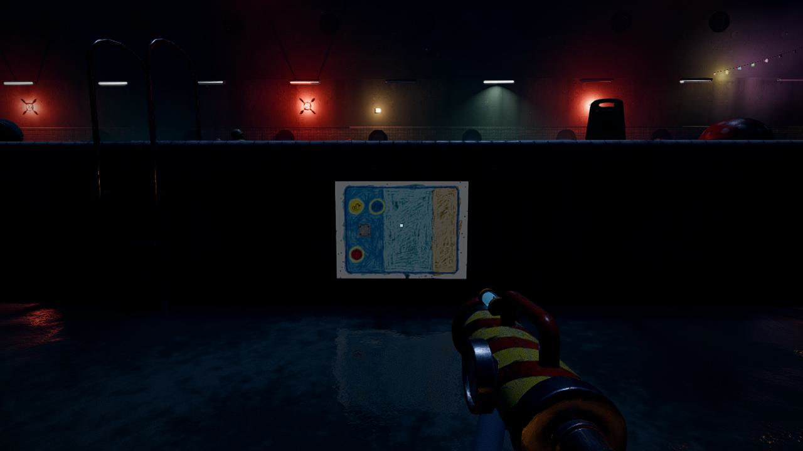
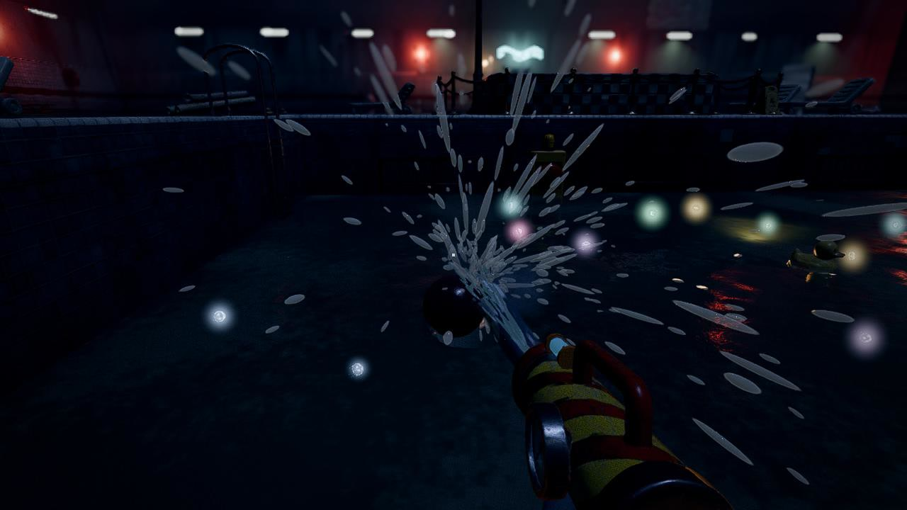
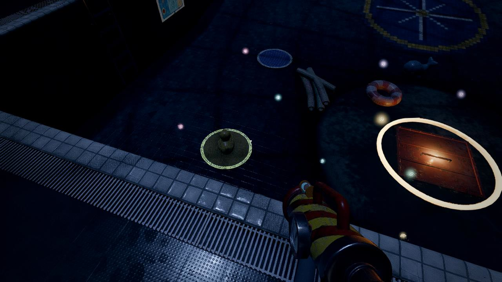
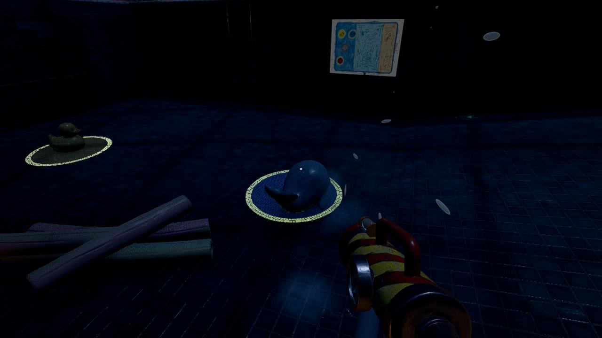
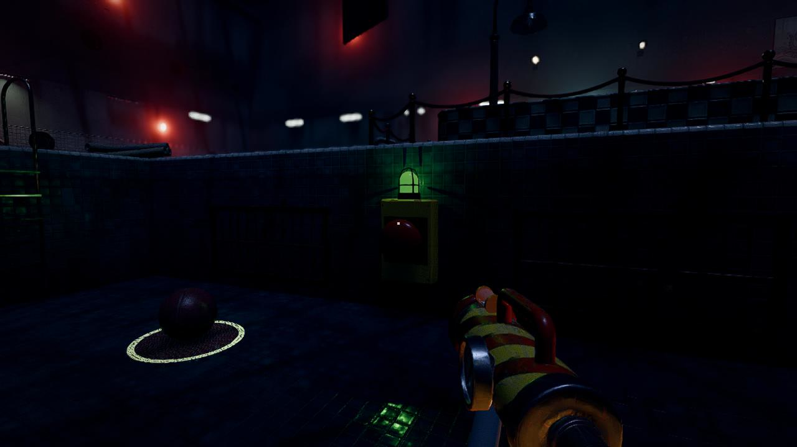
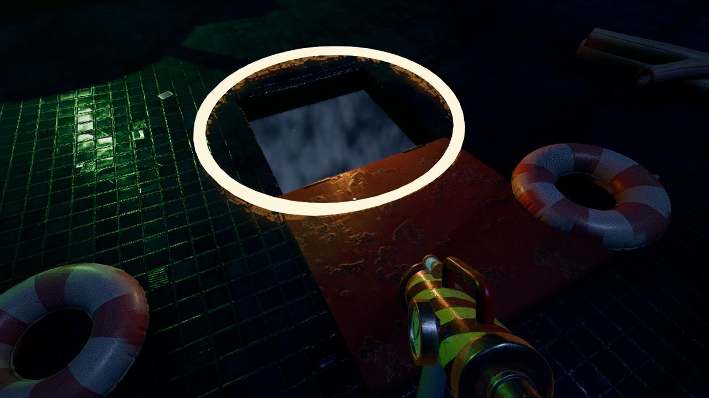

**Il collaudo da vicino**, con una torcia sulla camera: i giocattoli e i piatti a piscina vuota, i piatti scesi coi giocattoli sopra, i gonfiabili spostati sulla spiaggia. Niente distacchi né compenetrazioni.

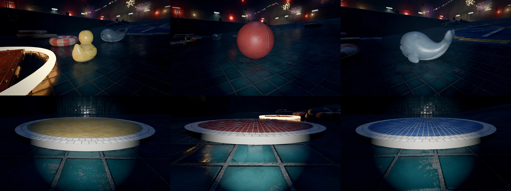
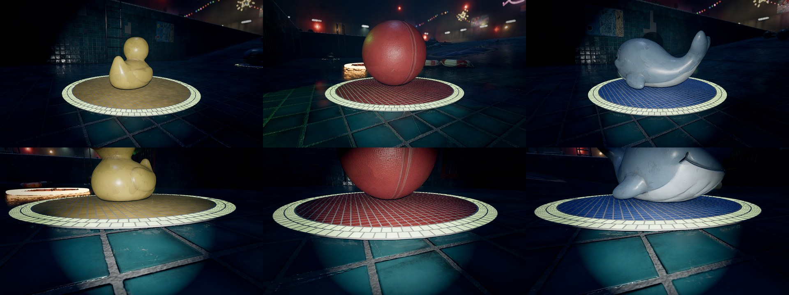
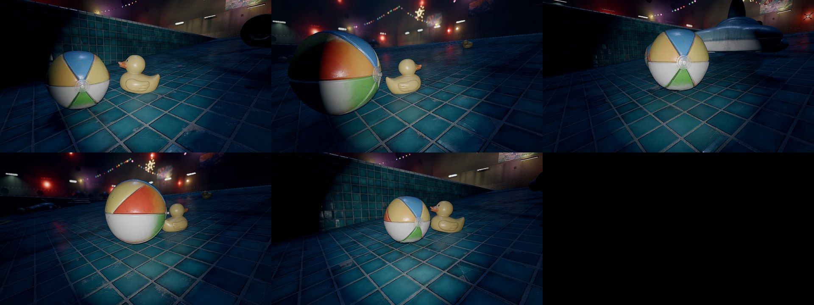

**Pipeline** (contate nel motore, `Performance`, durante il video): a metà enigma non si compilano pipeline nuove che fermano il disegno (draw) nel disegno, nei piatti che scendono, sul fondo vuoto, nella luce verde e nella botola.
- Nella spinta sull'acqua se ne compilano 4. Ma nel video lo zaino si usa lì per la prima volta, mentre nel gioco si usa già negli interni.
- Rifatto usando prima getto e aspirazione sull'acqua e il getto su un muro, come nel gioco (`video_enigma_giocattoli.gd ... adesca`), nella spinta sull'acqua se ne compilano 0: venivano tutte dal primo uso dello zaino, non dall'enigma.
- Le pipeline di specializzazione (fino a 9) si compilano in sottofondo e non fermano il disegno.

## Cosa cambia nel gioco

- `scripts/game/enigma_giocattoli.gd`: l'enigma, con il nodo `Piscina/EnigmaGiocattoli` nella sala.
  - I cerchi li appoggia sul fondo Posa, lo strumento comune.
  - Quello che si vede si disegna una volta fuori vista appena la sala è pronta, sullo strato 1<<15 (`RiscaldamentoShader.disegna_fuori_vista`), così a metà enigma non si compilano pipeline nuove.
  - Lo stato si salva coi checkpoint: dove sono i giocattoli e quali piatti sono scesi.
  - Il disegno ha un filo di luce propria (`luce_disegno`, 0,12; da approvare, vedi sotto).
- `scripts/game/piscina_onde.gd`: c'è la `serratura`.
  - A piscina vuota il pulsante della botola si preme solo a serratura aperta.
  - Il lampeggiante è giallo prima e verde dopo, e verde fisso quando la botola è aperta.
  - Senza serratura funziona come prima.
- **Test**:
  - `tests/test_enigma_giocattoli.gd` risolve l'enigma nei due ordini col giocatore e il getto veri; è nella CI;
  - `test_tappe56` mette i giocattoli al loro posto con una scorciatoia prima di colpire il pulsante;
  - nel controllo di posizionamento ci sono gli stati `piscina_vuota` e `piatti_scesi`: 0 casi nuovi;
  - il video e gli scatti si rifanno con `tests/video_enigma_giocattoli.gd`, `scatti_giocattoli_vicino.gd`, `scatti_giocattoli_arredo.gd` e `scatti_disegno_luce.gd`.
- **Partenze del menu di prova**: `genera_partenze_prova.gd` mette l'enigma risolto nella parte della piscina. Le partenze si rifanno dopo l'unione con le Polaroid nuove, per non far litigare i file.

## Cosa manca e da decidere

1. **Il disegno ha un filo di luce propria**, come se fosse fatto coi pastelli fosforescenti (come il bordo dei cerchi), con intensità 0,12 (scatto 1).
   - Senza luce, al buio della piscina, da 4 m non si legge: si vede solo un rettangolo scuro (scatto qui sotto, dal punto del video di prima, un po' più lontano).
   - A 0,3 sembra uno schermo acceso.
   - L'alternativa è una lampada sul bordo, sopra il disegno.

   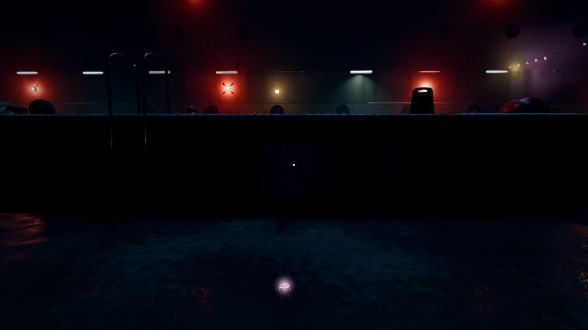
   
2. **I suoni sono provvisori**, presi fra quelli che ci sono già:
   - il tonfo del piatto è la fine della saracinesca, più grave;
   - il risucchio dagli scarichi è lo svuotamento della piscina, rallentato.
   Se servono suoni fatti apposta, li chiedo alla squadra audio.
3. **Il fianco dei piatti è chiaro**, come il bordo di piastrelle: si vede bene a piscina vuota, quando i piatti sporgono di 3 cm (foglio del collaudo, piscina vuota).
4. **Le partenze del menu di prova** (F9) si rifanno dopo l'unione con le Polaroid nuove, perché i due branch cambiano gli stessi file. In quella della piscina l'enigma è già risolto.
