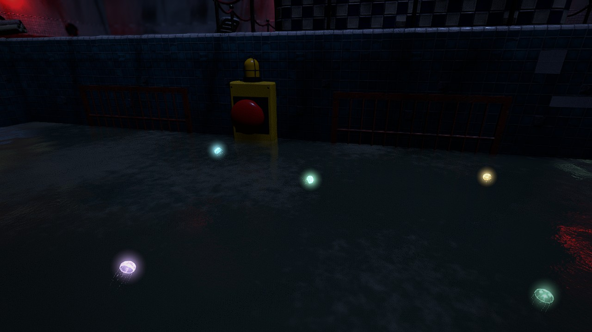
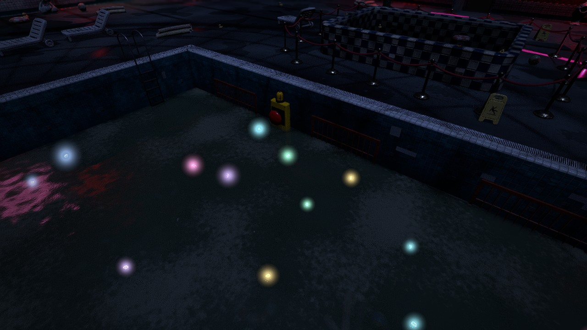
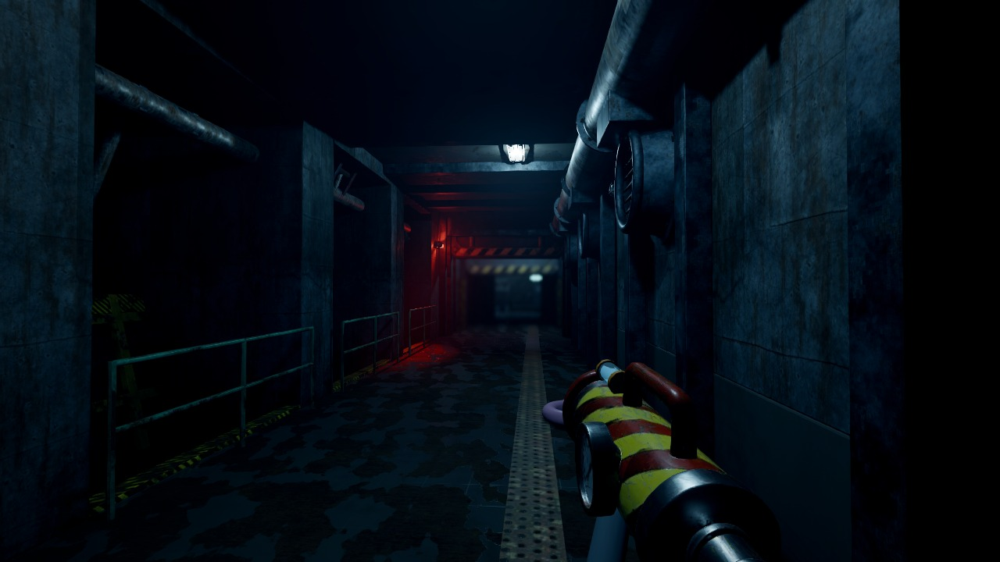
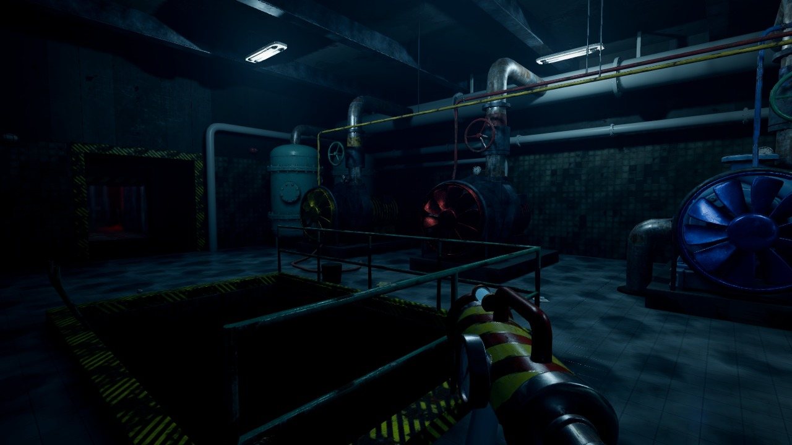
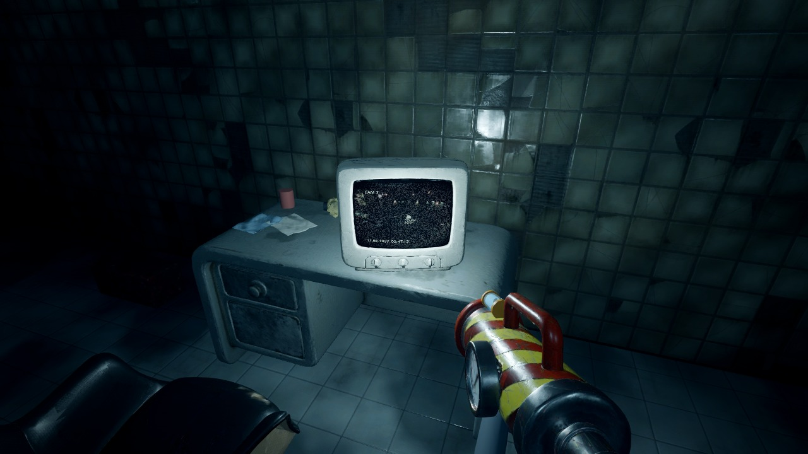

# Un enigma nuovo in una zona che c'è già: tre idee (proposta del 25 ottobre notte)

Richiesta approvata dall'utente: un enigma di 3-5 minuti, come gli acquari, in una zona che c'è già. Qui ci sono tre idee, ognuna con la logica completa. **Non è costruito niente: sceglie l'utente.** Tutte e tre seguono le regole del capitolo:
- solo disegni, niente da leggere;
- si usa lo zaino;
- se sbagli non si muore, si rifà;
- l'indizio è nell'ambiente;
- si sente di essere guidati.

Ognuna porta un **verbo nuovo** dello zaino, che negli altri enigmi non c'è ancora:

| | Dove | Verbo nuovo | Durata | Cosa apre |
|---|---|---|---|---|
| **A** "I giocattoli al loro posto" | Piscina a onde (tappa 5) | spingere col getto le cose che galleggiano | 3-4 min | la botola del fondo, come ora |
| **B** "I disegni nascosti" | Camera delle onde (tappa 5-6) | bagnare i muri per far comparire i disegni | 3-4 min | la porta stagna del tunnel verso la sala pompe |
| **C** "La telecamera" | Sala pompe (tappa 6) | guardare lontano, girando la telecamera col getto | 2-3 min in più | l'ordine delle turbine, poi la leva come ora |

La squadra consiglia la **A**. Si vede bene da lontano, usa l'acqua della piscina (il punto forte del gioco) e allunga la tappa più corta: ora la piscina si svuota in 30 secondi e poi c'è solo il pulsante.

---

## A · Piscina a onde: "I giocattoli al loro posto"

**Dove**: la parte profonda della piscina a onde, attorno alla pozza e alla botola. Oggi si svuota la pozza con 4 zainate e si colpisce il pulsante della botola.

**Cosa c'è di nuovo**
- Sul fondo, attorno alla botola, ci sono **tre cerchi di mosaico**: giallo, rosso e blu, larghi circa un metro. Sono piatti che si abbassano col peso: la serratura della botola.
- Nella pozza galleggiano **tre giocattoli grandi**, di gomma e mezzi pieni d'acqua, quindi pesanti: una paperella gialla, un pallone rosso e una balena blu.
- **L'indizio**: sul muro della parte profonda c'è un disegno a pastello dei bambini, nello stile di quello degli acquari. Mostra la piscina vista dall'alto con i tre giocattoli, ognuno dentro il suo cerchio.

**Come si gioca**
1. Col getto **spingi i giocattoli** sull'acqua della pozza: il getto fa da corrente, e più sei vicino più spinge. Quando un giocattolo galleggia sopra il suo cerchio, il bordo del cerchio, fatto di piastrelle fosforescenti, si accende appena.
2. Poi **svuoti la pozza come ora**, 4 zainate sparate fuori dalla vasca (quella sparata dentro ci ricola).
3. Mentre l'acqua cala i giocattoli si posano. Se ognuno è sul suo cerchio, ogni piatto scende con un tonfo. A fondo asciutto la luce del pulsante della botola passa da gialla a verde, lo colpisci col getto e la botola si apre, come ora.

**Se sbagli**: a pozza vuota un piatto non scende e la luce resta gialla. I giocattoli si spingono anche sul fondo bagnato, più piano, perché strisciano sulle piastrelle. Si sistemano lì e il piatto scende. Niente da rifare da capo.

**Durata**: 3-4 minuti:
- trovare il disegno e capire: 1 minuto;
- spingere i tre giocattoli, con le medusine colorate che distraggono: 1-2 minuti;
- svuotare, come ora: 30 secondi.

**Tensione**
- La statua resta sul bordo, proprio sopra la parte profonda: mentre lavori sul fondo lei è sopra di te e non si muove, come già previsto.
- Quando scende l'ultimo piatto, dagli scarichi arriva un risucchio lungo, come un respiro.
- La paperella è quella delle Polaroid.

**Cosa cambia nel gioco**: svuotamento, pulsante e botola restano; prima si aggiunge la parte dei giocattoli. La P5, sul fondo sotto la pozza, resta dov'è.

---

## B · Camera delle onde: "I disegni nascosti"

**Dove**: la camera delle onde, i 24 metri fra il pozzo della botola e il tunnel verso la sala pompe. Oggi la si attraversa e basta.

**Cosa c'è di nuovo**
- Il tunnel verso la sala pompe è chiuso da una **porta stagna rotonda con quattro chiavistelli**. Ogni chiavistello è mosso da una **valvola colorata** lungo i muri della camera: gialla, rossa, blu e verde. Ogni valvola ha una piccola girante a pale, larga 40 cm, che il getto fa girare come le turbine della sala pompe.
- Delle quattro ne vanno girate **tre**. La rossa non è un chiavistello ma lo scarico della camera: se la giri, dalle bocchette entra acqua fino alle caviglie e tutte le valvole tornano indietro con un risucchio. Si rifà. Niente morte.
- **L'indizio, la cosa nuova**: le piastrelle bianche della camera sembrano pulite. I bambini però ci hanno disegnato con la cera di una candela, come nel gioco del disegno segreto, perché la cera respinge l'acqua. **Bagnando i muri col getto i disegni compaiono**, scuri sulle piastrelle bagnate, e svaniscono piano in un minuto, quando il muro si asciuga.
- Fra pesci, manine e Jilly coi bambini (lo stile della P6, le tacche, che è proprio qui), un disegno mostra la porta rotonda con tre manine sopra tre cerchi: giallo, blu e verde. Accanto c'è un cerchio rosso cancellato da una croce, con una goccia.

**Come si gioca**
1. Arrivi alla porta chiusa e vedi le quattro valvole.
2. Spruzzando i muri, anche solo per caso o per gioco, compare un primo disegno. Si capisce che i muri nascondono qualcosa.
3. Bagni i muri finché trovi il disegno della porta.
4. Giri col getto la gialla, la blu e la verde: i tre chiavistelli si sfilano e la porta si apre.

**Acqua**: dalle pozze sul pavimento della camera e dalla bocchetta che gocciola, sempre a portata.

**Durata**: 3-4 minuti: bagnare i muri cercando 1-2 minuti, girare le valvole 1 minuto, più l'eventuale errore con la rossa.

**Tensione**: bagnando i muri compaiono anche cose che non c'entrano. Tantissime manine che salgono verso il soffitto. E, dove prima non c'era niente, una sagoma alta con un occhio solo: il disegno di lei, a grandezza vera.

**Cosa cambia nel gioco**: le pale, le bocchette e le paratie restano; le paratie si abbassano dopo la leva, come ora. Si aggiungono la porta stagna, le quattro valvole e i disegni a cera.

---

## C · Sala pompe: "La telecamera"

**Dove**: la sala pompe. Oggi si girano col getto le tre turbine nell'ordine dello schema a colori sul muro (blu, giallo, rosso) e poi si colpisce la leva dietro la grata.

**Cosa c'è di nuovo**
- Lo schema a colori sul muro c'è ancora, ma è coperto quasi tutto da un grande disegno a pastello dei bambini, una Jilly gigante: si vede solo il primo colore.
- Il **monitor a tubo** sulla scrivania mostra la sala grande da una telecamera. Accanto, sul muro, il motore della telecamera ha una piccola girante. Colpita col getto da sinistra la telecamera gira a sinistra, da destra gira a destra. Si vedono la girante che gira e l'immagine del monitor che scorre, con il ronzio del motorino.
- Girando la telecamera si vede la sala grande: la statua, ancora sul piedistallo prima delle pompe, e più in là, sul bordo della vasca di Jilly, **tre giocattoli messi in fila dai bambini**. Da sinistra: una barchetta blu, una paperella gialla, un pallone rosso. È l'ordine delle turbine. I giocattoli ci sono davvero nella sala grande, anche se passandoci prima non si capisce a cosa servono.

**Come si gioca**
1. Lo schema coperto dice solo il primo colore.
2. Il monitor attira lo sguardo: si scopre che la telecamera si gira col getto.
3. Girandola si trovano i tre giocattoli in fila.
4. Le turbine nell'ordine e poi la leva, come ora.

**Il momento B3**, già previsto nel livello: mentre giri la telecamera una sagoma piccola passa davanti alla statua e le appoggia una mano sul piedistallo. Se torni indietro con la telecamera non c'è più.

**Se sbagli**: come ora. Una turbina nell'ordine sbagliato si ferma, e le altre si fermano con lei.

**Durata**: 2-3 minuti in più rispetto a ora.

**Cosa cambia nel gioco**: lo schema a colori, scelto nel piano del livello del 14 ottobre, resta ma coperto. Si aggiungono il motore della telecamera e i giocattoli in fila nella sala grande. È la più piccola delle tre.

---

## Da decidere con l'utente

1. Quale delle tre, oppure nessuna. La squadra consiglia la A.
2. Se serve, prima di costruirla, una prova con gli asset veri: per esempio i giocattoli e i cerchi nella pozza, scattati dal motore.
