# Inseguimento I1 e finale SB1: due proposte

Si parte dalla bocca dell'inseguimento, sul muro est in fondo alla torre (-18 m). Dietro quel muro c'è una sala nuova, ricavata nello scafo. Le due versioni hanno la stessa sala di partenza ma un percorso diverso.

Tutte le immagini vengono da modelli veri: le piante e le viste di lato sono render di Blender, gli scatti sono presi da Godot. Nel gioco non c'è ancora niente.

## Regole comuni

- **Niente torcia.** Ci si orienta con:
  - le luci rosse d'emergenza ai muri;
  - le lampade da lavoro calde nelle vasche;
  - i fari da cantiere legati alle ringhiere delle passerelle;
  - il bagliore rosa di lei, che nel buio e nella nebbia si vede da lontano;
  - la scia rosa: dove lei è già passata, sul bordo resta la bava fosforescente, che dice da che lato arriverà.
- **Le paratie si leggono al buio.** A ogni bivio ci sono due paratie a ghigliottina con un bersaglio giallo e nero.
  - Sopra quella **giusta** c'è una lampada **verde** accesa, che illumina il bersaglio, e attorno al bersaglio un **anello di led verdi**.
  - Sopra quella **sbagliata** c'è una lampada **rossa guasta** che sfarfalla, e il bersaglio resta spento.
  - Si colpisce il bersaglio col getto per circa 1,5 secondi: la paratia sale, l'acqua parte e si scivola via.
- **Lei.** È alta 4,5 m e nei tubi da 1,6 m non entra: ti raggiunge dove il percorso si apre, cioè nelle vasche, nei canali aperti e alla fine.
  - Quando compare hai circa 6 secondi prima che ti prenda.
  - Un getto in faccia la respinge: si ritrae sotto e torna dopo 8-10 secondi.
  - Nelle vasche l'acqua scorre, quindi lo zaino si ricarica (Z1).
- **Errore.** La paratia sbagliata porta in una vasca di scolo senza uscita, dove lei ti prende. La morte si può saltare e si riparte dalla vasca del bivio: si perdono circa 30 secondi.
- **Checkpoint invisibili** alla bocca e a ogni vasca.
- **La fine.** Quando arrivi in fondo, la grata di sicurezza cala davanti a lei e lei ci sbatte contro. Poi esci dalla porta di servizio.
- **SB1.** Prima di uscire, lei sbuca dal bordo del **pozzo di scarico**, profondo 4,5 m, e ti guarda. È l'ultima immagine del capitolo, poi lo schermo va al nero.

## Versione A, "Le condotte"

Una sala macchine vera, allagata sul fondo. Ci sono:
- le tre pompe della sala pompe (gialla, rossa e blu) sui loro basamenti, il filtro grande, i serbatoi, le condotte;
- un ballatoio contro il muro est con il quadro elettrico e il volano della turbina;
- un balcone di controllo sul muro sud con la scrivania, la sedia e il quadro strumenti;
- valvole, manometri, cassette elettriche, cavi a festone sotto le passerelle, cartelli e lamiere cadute;
- lampade industriali appese al soffitto e plafoniere al neon.

Ogni oggetto compare una volta sola e tutto è appoggiato o appeso a qualcosa. Si scivola in **tubi chiusi** da una vasca di smistamento all'altra: tre vasche sospese, tre bivi. Dalla bocca alla porta sono 125 m di percorso e 15 m di dislivello.

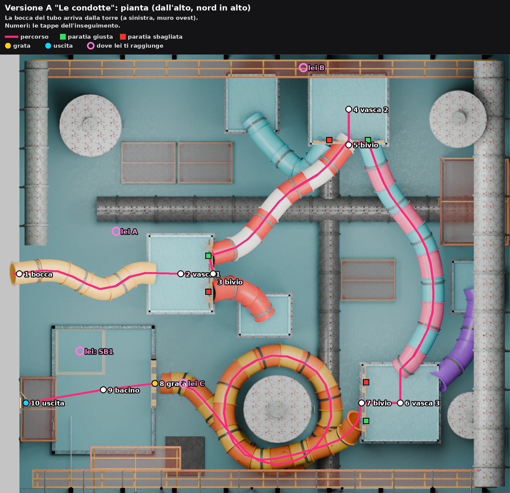
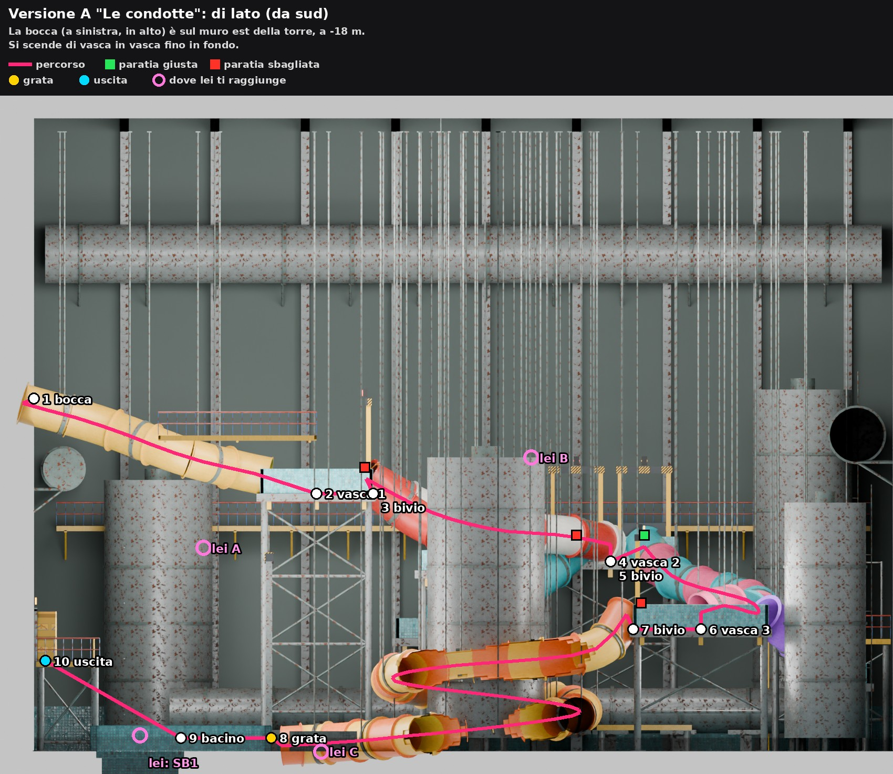

| Tappa | Cosa succede | Tempo |
|---|---|---|
| Bocca, tubo giallo (15 m) | Si scende nella sala buia. | 0:15 |
| Vasca 1, bivio 1 | Bivio facile: la giusta è a nord. Dopo circa 20 secondi lei sale da sotto la vasca (lei A): la prima volta la respingi. | 0:45 |
| Tubo bianco e rosso (19 m) | | 0:15 |
| Vasca 2, bivio 2 | Lei arriva subito dalla condotta nord (lei B). La paratia sale piano (3 s): devi respingerla una volta mentre si apre. | 1:15 |
| Tubo turchese e rosa (25 m) | | 0:20 |
| Vasca 3, bivio 3 | Lei torna due volte. La giusta è quella più lontana, a sud. | 1:30 |
| Spirale arancione (48 m) | Gira attorno al serbatoio grande, fino in fondo. | 0:40 |
| Bacino, grata | Atterri nel bacino; la grata cala sulla bocca del tubo dietro di te e lei ci sbatte contro (lei C). | 0:20 |
| Scaletta, passerella, porta | Vai verso la scaletta: SB1, lei sbuca dal pozzo di scarico a pochi metri e ti guarda. Nero: fine del capitolo. | 0:40 |

**In totale circa 5:40 senza errori; con un errore, circa 7 minuti.** La A alterna fasi: nel tubo non la vedi, nelle vasche sì. Ogni vasca è un piccolo enigma sotto pressione: leggi le luci, colpisci il bersaglio, respingila.

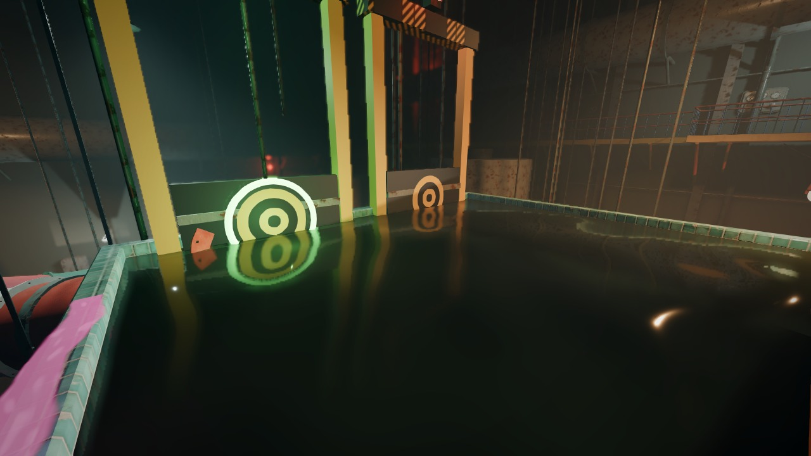
*Vasca 1: le due paratie del primo bivio. A sinistra la giusta, con la luce verde e l'anello di led; a destra la sbagliata, con la lampada rossa guasta.*

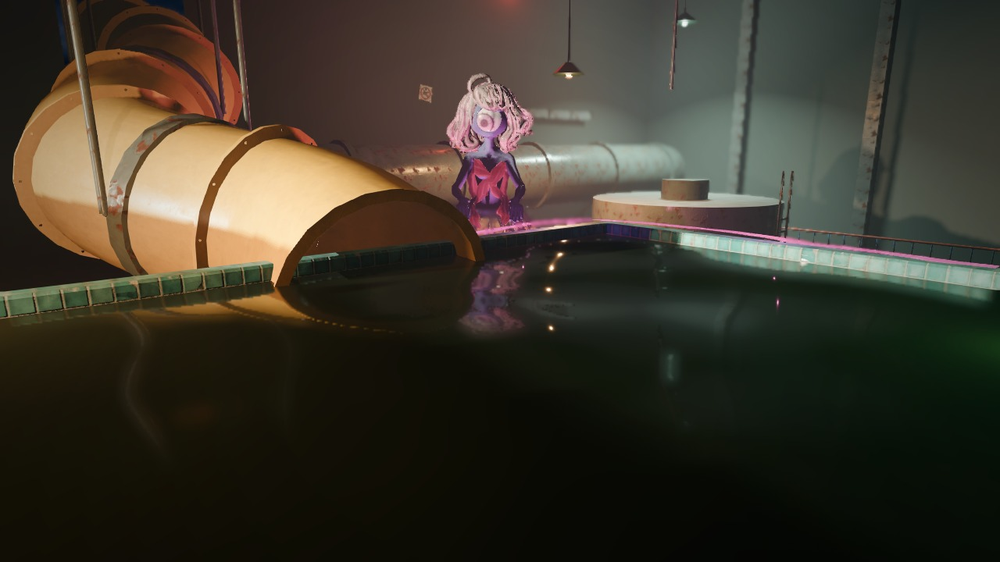
*Vasca 1: lei sale accanto al tubo da cui sei arrivato. Sul bordo, la sua bava rosa; dietro, la condotta sul muro ovest e le lampade appese.*

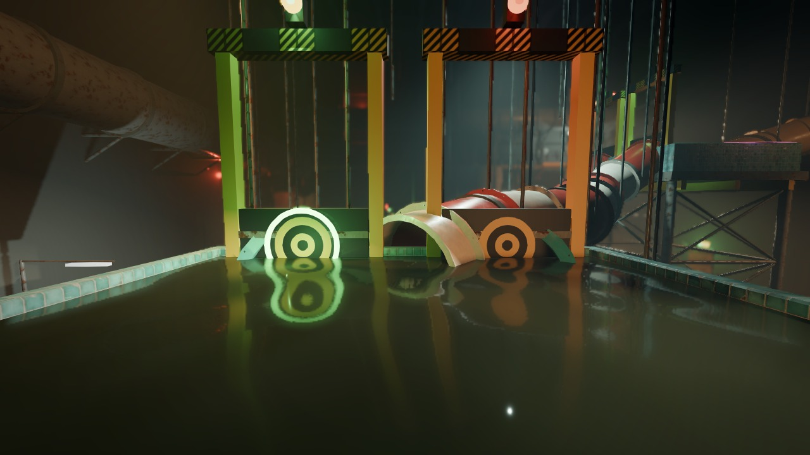
*Vasca 2: il secondo bivio. In mezzo, la bocca del tubo da cui sei arrivato.*

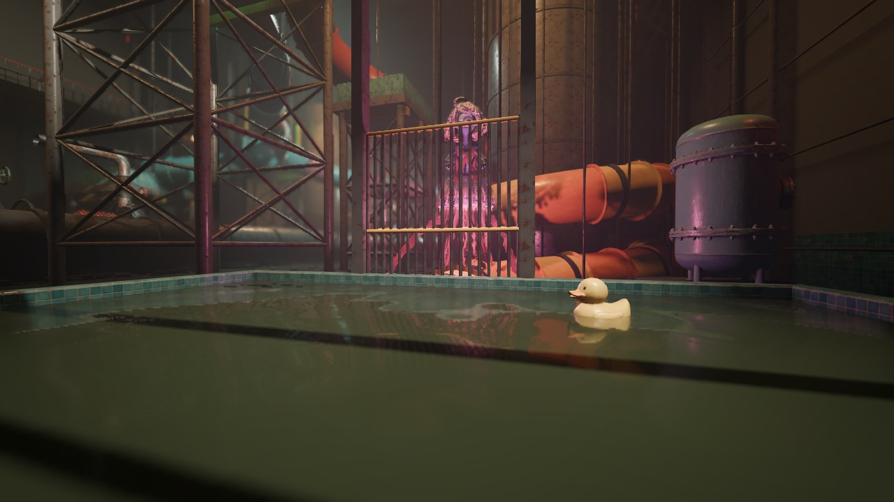
*Il bacino in fondo: la grata è calata e lei resta dietro. Intorno, il filtro grande, il serbatoio e la spirale.*

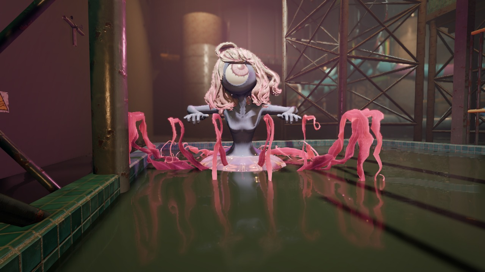
*SB1: vicino alla scaletta per uscire, lei sbuca dal bordo del pozzo di scarico, a pochi metri.*

## Versione B, "Le rapide"

Una giostra diversa dal fiume lento: **le rapide**, acqua bianca e schiuma in un canale tra scogli finti. Ci sono:
- l'insegna "LE RAPIDE" sul portale della partenza e i cartelli della giostra ("Attenzione salto!", "Vietato alzarsi", l'uscita verde);
- un canyon di scogli finti di vetroresina dipinta contro i muri, tutti diversi;
- i gommoni tondi da sei posti rovesciati sul fondo e i murales;
- tre tralicci di scena con i fari accesi, colorati, puntati sul canale;
- i lampioncini del percorso sulle sponde ogni 6 m: la strada si legge anche senza torcia.

Dopo un tubo corto si arriva nella vasca di partenza, poi si scende nel **canale aperto**, con tre bivi attorno a uno scoglio. Dalla bocca alla porta sono 108 m e 17 m di dislivello. Sotto il canale c'è il bacino di raccolta della giostra, con l'acqua ferma.

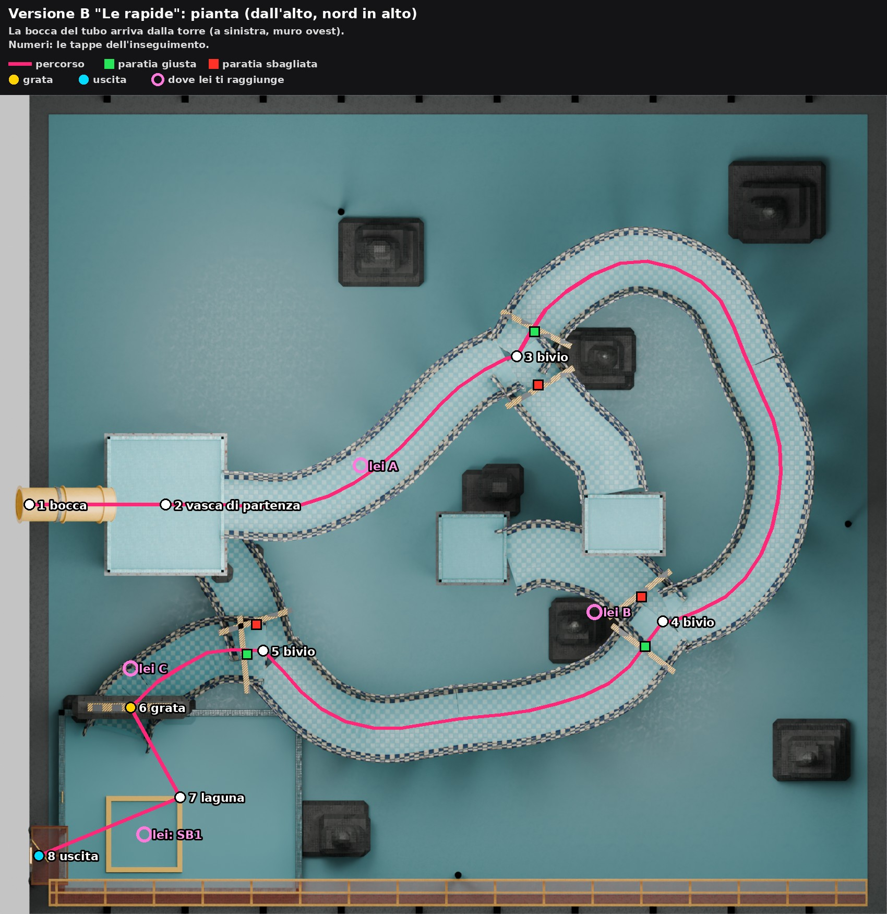
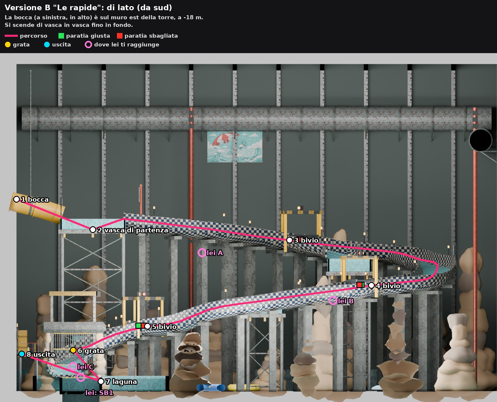

| Tappa | Cosa succede | Tempo |
|---|---|---|
| Bocca, tubo corto, vasca di partenza | | 0:40 |
| Canale (21 m) | La corrente ti porta. Lei nuota nel canale dietro di te (lei A): ti giri e la respingi mentre scivoli. | 0:40 |
| Bivio 1 | Il canale si allarga in una pozza e la corrente rallenta. Colpisci la giusta mentre ti spinge verso le paratie. | 1:00 |
| Canale con un salto (34 m) | | 1:00 |
| Bivio 2 | Lei sale sullo scoglio in mezzo al bivio (lei B), proprio davanti alle paratie. | 1:00 |
| Canale (24 m) | | 0:40 |
| Bivio 3 | Lei è dietro di te nel canale. | 0:45 |
| Ultimo salto, grata, laguna | La saracinesca sotto l'arco cala dietro di te; lei ci sbatte contro (lei C). | 0:30 |
| Scaletta, pontile, porta | SB1: lei sbuca dal pozzo di scarico della laguna. | 0:40 |

**In totale circa 6:30 senza errori.** La B è più d'azione e ha meno pause: lei la vedi quasi sempre, dietro di te nel canale, e i bivi si fanno con la corrente che spinge.

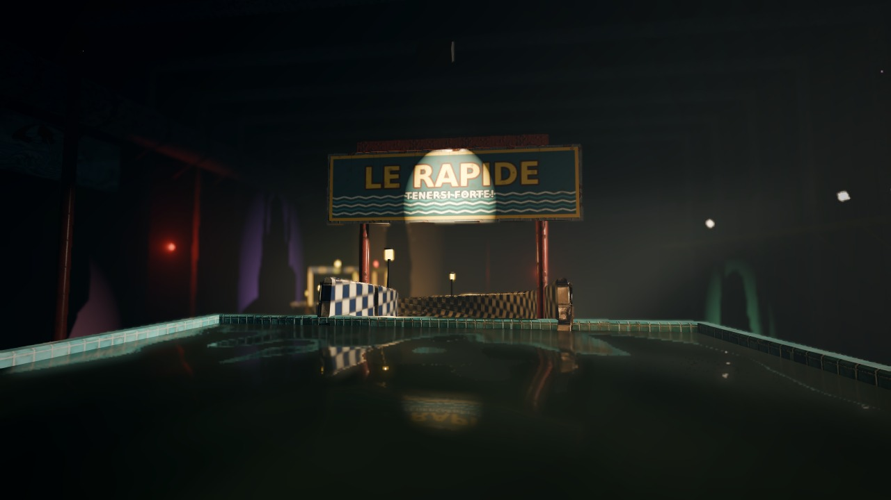
*La vasca di partenza: il portale con l'insegna "LE RAPIDE" e l'inizio del canale.*

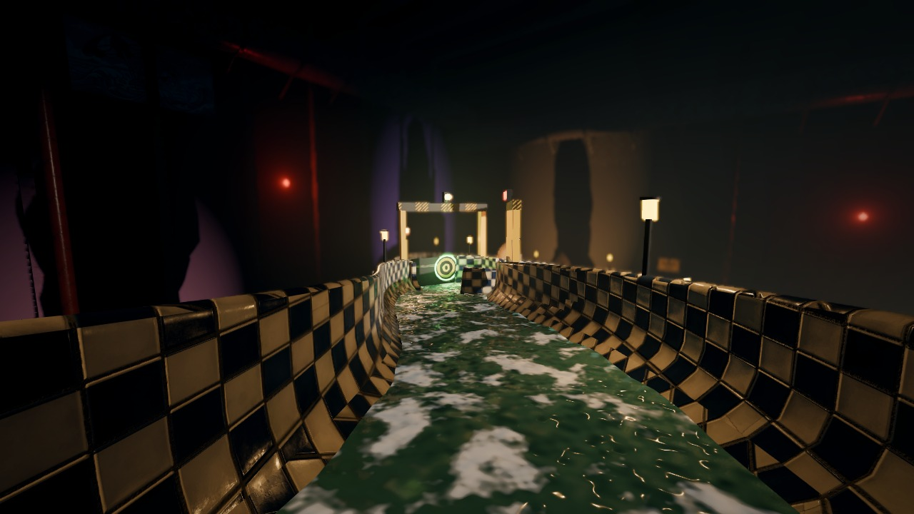
*Nel canale delle rapide, verso il primo bivio: senza torcia la strada si legge con la schiuma, i lampioncini sulle sponde, gli scogli illuminati dal basso e il bersaglio verde in fondo.*

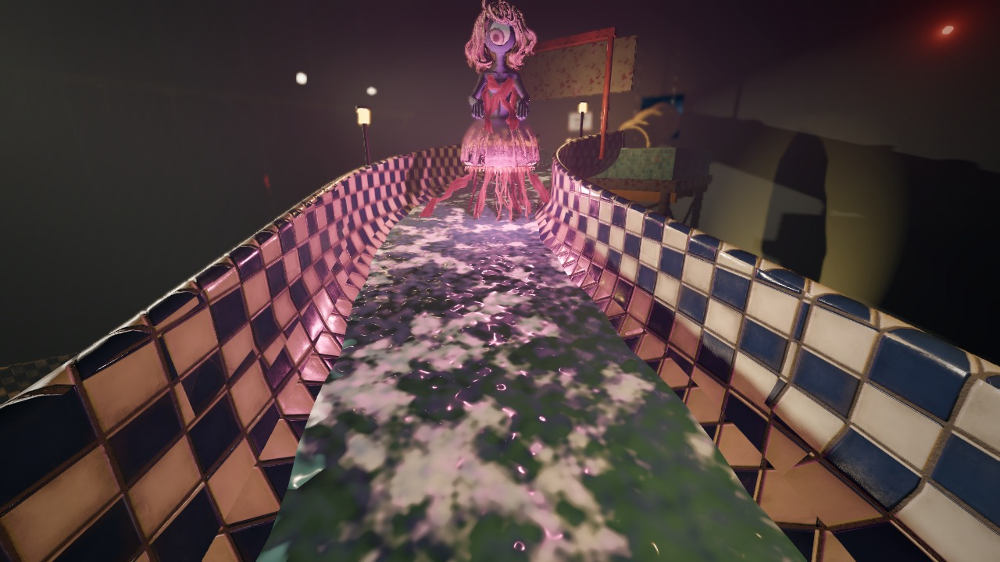
*Lei nuota nel canale dietro di te.*

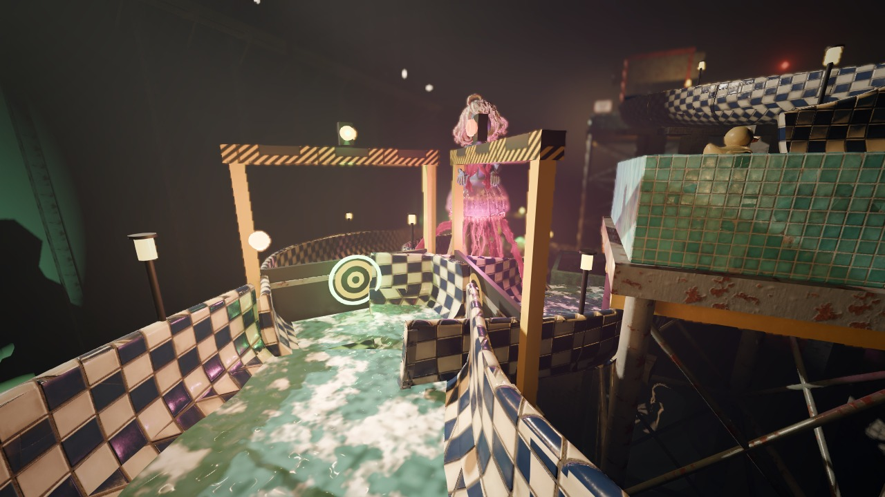
*Il secondo bivio, con lei sullo scoglio.*

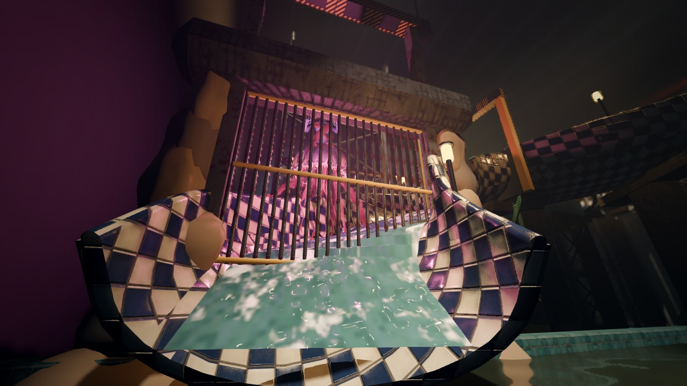
*La laguna: la saracinesca è calata sotto l'arco.*

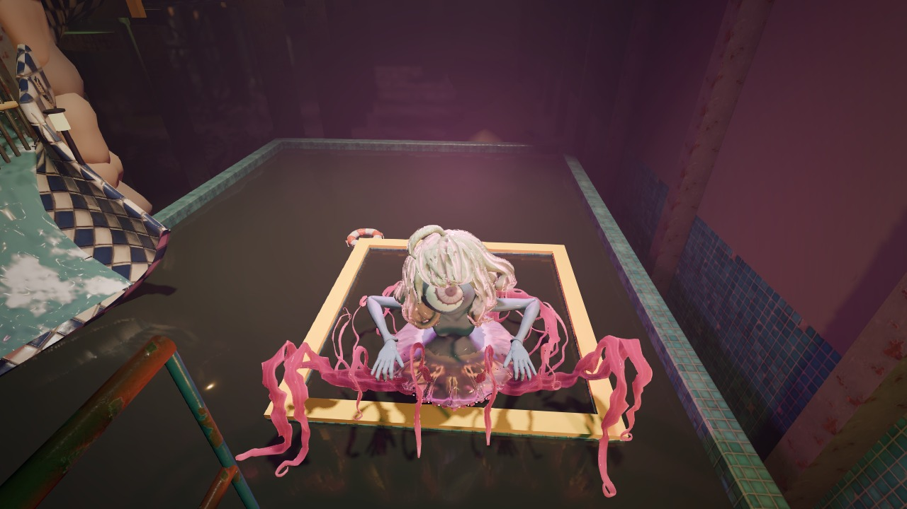
*SB1: dal pontile della porta, lei sbuca dal pozzo di scarico della laguna e si aggrappa al bordo.*

## Per scegliere

- **A**: claustrofobica e a fasi (tubo, vasca, tubo), più vicina all'idea di "scivolata negli scivoli" del GDD. Si porta nel gioco riusando la tecnica dei tubi della torre. Stima: 10-12 ore.
- **B**: più aperta e spettacolare, con lei sempre in vista. Il canale aperto con la corrente è un pezzo nuovo da fare. Stima: 12-14 ore.
- Si possono anche mescolare, per esempio la sala e i tubi della A con il finale della laguna della B.

I generatori sono `tools/blender/inseguimento_proposte.py` (A/B) e `inseguimento_viste.py`. I sostegni si controllano con `inseguimento_sostegni.py`: zero pezzi sospesi in tutte e due le versioni. Gli scatti si fanno con `godot/proposte/inseguimento/scatti_inseguimento.gd`.
