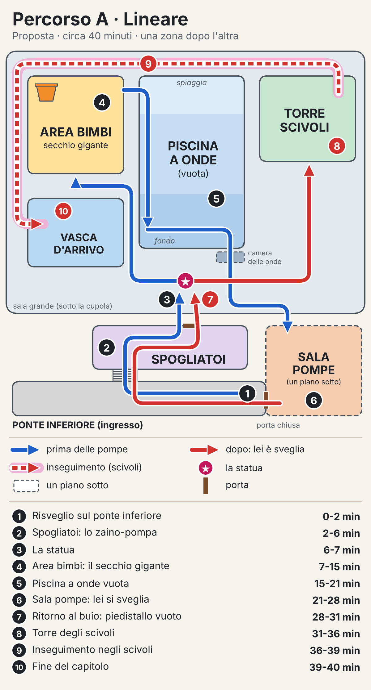
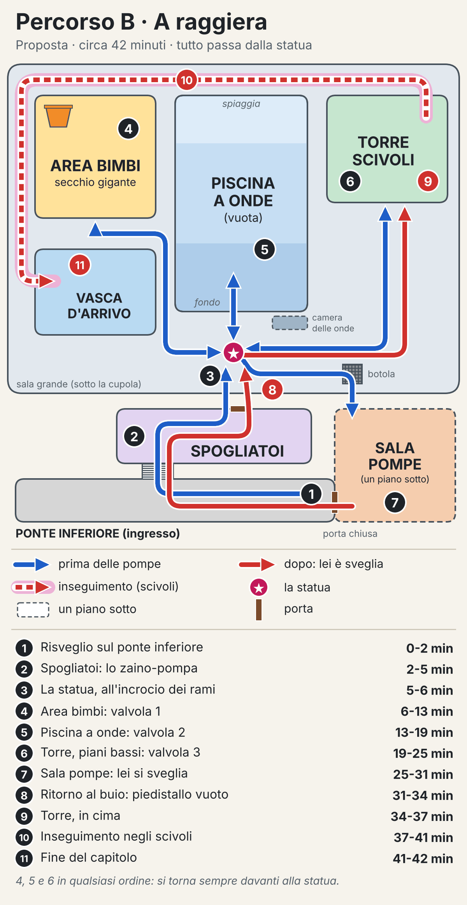
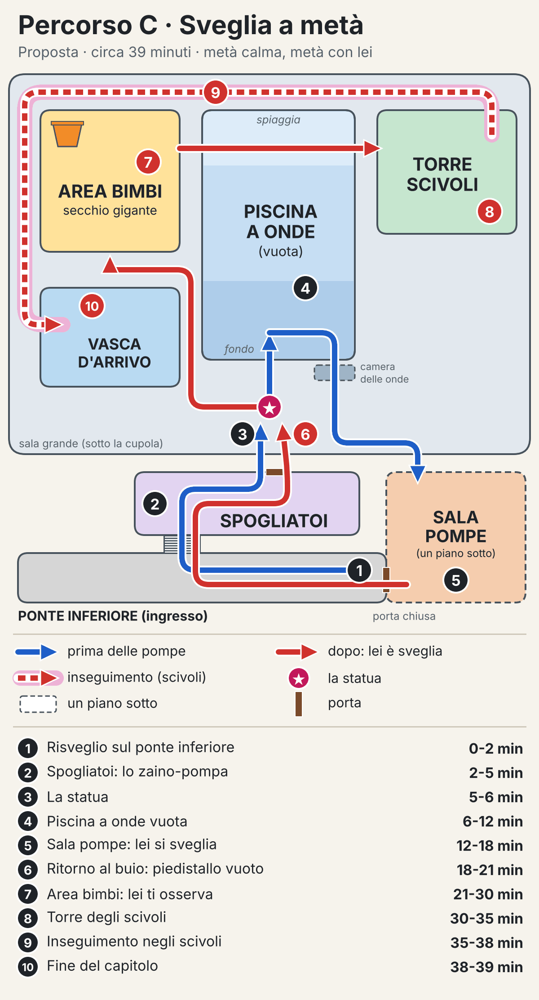

# Capitolo 1 · Proposte per il livello

> Tutto quello che c'è qui è una **proposta**: le scelte sono tue. I minuti sono stime.

## 0. Riassunto

- Tre percorsi, ognuno con la sua mappa: **A lineare** (~40 min), **B a raggiera** (~42 min), **C sveglia a metà** (~39 min).
- Già deciso nel GDD, uguale in tutti: ingresso dal ponte inferiore, statua tra il 5° e il 7° minuto, le pompe la svegliano, finale negli scivoli.
- Proposto per tutti e tre: lo zaino-pompa si trova negli spogliatoi; dopo le pompe torni dagli spogliatoi al buio e trovi il piedistallo vuoto.
- Ogni zona ha un enigma con lo zaino-pompa e un momento di paura (sezione 2).
- Statua e piedistallo vuoto: 2 varianti ciascuna (sezione 3).
- Inseguimento: scivolata veloce oppure fuga a piedi nei tubi (sezione 4).
- Idee opzionali: oggetti da collezione, checkpoint, morte (sezione 5).
- In fondo ci sono le scelte con le sigle: puoi rispondere anche solo "A, S1, V2, I1".

## 1. Tre percorsi a confronto

- **A · Lineare**: una strada sola, la paura cresce piano. Circa 40 minuti.
- **B · A raggiera**: tre rami in ordine libero, tutto passa dalla statua. Circa 42 minuti.
- **C · Sveglia a metà**: pompe presto, metà capitolo con lei sveglia. Circa 39 minuti.

**Come leggere le mappe**

- Blu: prima delle pompe. Rosso: dopo, quando lei è sveglia.
- Tratteggio rosso sulla fascia rosa: l'inseguimento negli scivoli.
- Stella rosa: la statua. Riquadro tratteggiato: un piano sotto.
- I numeri seguono l'ordine di gioco.

**La pianta è la stessa nei tre percorsi** (anche questa è una proposta):

- Una sola grande sala sotto la cupola di vetro: piscina a onde vuota al centro, area bimbi a sinistra, torre degli scivoli a destra.
- Gli scivoli girano lungo i bordi della sala e finiscono nella vasca d'arrivo, che fa parte della zona degli scivoli.
- Gli spogliatoi collegano il ponte inferiore alla sala. Appena esci, vedi la statua.
- La sala pompe è un piano sotto. La sua porta sul ponte inferiore è chiusa: la vedi al primo minuto e la riapri da dentro dopo le pompe.

### Percorso A · Lineare

**L'idea:** una zona dopo l'altra, come il primo capitolo di Poppy Playtime. Venti minuti di calma sempre più strana, poi tutto precipita.

**Tappe e minuti**

1. Risveglio sul ponte inferiore · 0-2
2. Spogliatoi: trovi lo zaino-pompa · 2-6
3. La statua · 6-7
4. Area bimbi: il secchio gigante · 7-15
5. Piscina a onde vuota · 15-21
6. Sala pompe: lei si sveglia · 21-28
7. Ritorno al buio: piedistallo vuoto · 28-31
8. Torre degli scivoli · 31-36
9. Inseguimento negli scivoli · 36-39
10. Fine del capitolo · 39-40

**Pro**

- È il più facile da seguire e da costruire.
- La paura cresce in modo regolare.

**Contro**

- Poca libertà: c'è una strada sola.
- Dopo che lei si sveglia, il finale arriva presto.

### Percorso B · A raggiera

**L'idea:** la statua sta all'incrocio di tre rami, da fare nell'ordine che vuoi. Ogni volta che torni, lei è lì.

- Vicino alla statua c'è una botola con tre volantini colorati: è la strada per la sala pompe.
- Tre tubi colorati corrono lungo i muri. Ognuno porta alla sua valvola: area bimbi, fondo della piscina, piani bassi della torre.
- Aperte le tre valvole, la botola si apre.

**Tappe e minuti**

1. Risveglio sul ponte inferiore · 0-2
2. Spogliatoi: trovi lo zaino-pompa · 2-5
3. La statua, all'incrocio dei rami · 5-6
4. Area bimbi: valvola 1 · 6-13
5. Piscina a onde: valvola 2 · 13-19
6. Torre, piani bassi: valvola 3 · 19-25
7. Sala pompe: lei si sveglia · 25-31
8. Ritorno al buio: piedistallo vuoto · 31-34
9. Torre, fino in cima · 34-37
10. Inseguimento negli scivoli · 37-41
11. Fine del capitolo · 41-42

Le tappe 4, 5 e 6 si fanno in qualsiasi ordine.

**Pro**

- Più esplorazione e più libertà.
- Vedi la statua 4 o 5 volte: quando sparisce, colpisce di più.

**Contro**

- È il più lungo e chiede più enigmi da costruire.
- Serve una buona guida per non perdersi (i tubi colorati).

### Percorso C · Sveglia a metà

**L'idea:** la sala pompe arriva presto, verso il 15° minuto. La seconda metà la giochi con lei sveglia: si fa vedere, ti osserva, magari sbuca dall'acqua.

**Tappe e minuti**

1. Risveglio sul ponte inferiore · 0-2
2. Spogliatoi: trovi lo zaino-pompa · 2-5
3. La statua · 5-6
4. Piscina a onde vuota · 6-12
5. Sala pompe: lei si sveglia · 12-18
6. Ritorno al buio: piedistallo vuoto · 18-21
7. Area bimbi: lei ti osserva · 21-30
8. Torre degli scivoli, attraversando la piscina vuota · 30-35
9. Inseguimento negli scivoli · 35-38
10. Fine del capitolo · 38-39

**Pro**

- Più paura, e più a lungo.
- È il posto naturale per la scena di lei che sbuca dal bordo (sezione 3).

**Contro**

- Meno tempo tranquillo per imparare lo zaino.
- Da decidere: prima del finale lei può già prenderti, o si fa solo vedere?

## 2. Le zone, una per una

### Lo zaino-pompa nel capitolo

Dal GDD: il getto attiva turbine e pulsanti a distanza, riempie e svuota le vasche, dà una spinta per saltare e respinge i mostri per un attimo. L'aspetto dello zaino è ancora da decidere: qui non se ne parla.

**Proposta: una cosa nuova per volta**

- Spogliatoi: getto sui pulsanti, poi sulle turbine.
- Piscina e area bimbi: riempire e svuotare le vasche. L'acqua sale e scende davvero, come hai chiesto.
- Torre: la spinta per saltare (nel percorso B la impari nel ramo della torre).
- Inseguimento: respingere lei. La prima volta un'icona ti suggerisce di girarti e sparare.

**Da decidere (Z): come riempie e svuota le vasche?**

- **Z1 · È davvero una pompa:** aspira l'acqua da una vasca e la spara in un'altra. Ha un serbatoio che si vede sullo zaino. Più enigmi, più "fisico".
- **Z2 · Solo getto:** lo zaino spara e basta. Le vasche si riempiono o si svuotano colpendo valvole e turbine. Più semplice da capire e da fare.
- Con Z1, nell'inseguimento conta anche quanta acqua resta: negli scivoli il serbatoio si ricarica, perché l'acqua scorre.

### Ponte inferiore (ingresso)

**Cosa succede**

- Ti svegli a bordo, senza spiegazioni. La nave scricchiola, la tempesta batte sullo scafo, ci sono solo luci d'emergenza rosse.
- Dove ti svegli, da scegliere: per terra nel corridoio, oppure seduto su una sdraio bagnata.
- Un grande cartellone colorato mostra la mascotte disegnata, sorridente. È la prima volta che la vedi, in versione cartone animato.
- Proprio lì accanto c'è la porta della sala pompe, chiusa. La riaprirai da dentro, più avanti.

**Zaino-pompa:** non ce l'hai ancora. Solo camminare e guardarsi intorno.

**Tensione:** bassa. Alle tue spalle una porta tagliafuoco si chiude da sola: non si torna indietro.

### Spogliatoi

**Cosa succede**

- Armadietti, panche, docce e il corridoio con la vasca lava-piedi che porta in sala. Braccioli e ciabatte dimenticati.
- Nello stanzino dei bagnini trovi lo zaino-pompa. In alternativa: appeso alla postazione del bagnino, all'uscita.

**Zaino-pompa (si impara qui)**

- Il tornello d'uscita si sblocca con un pulsante fuori portata, dietro un vetro rotto: lo colpisci col getto.
- Poi una saracinesca: tieni il getto su una piccola turbina e la saracinesca sale piano. Arrivata in cima, resta su.

**Tensione**

- Le docce si aprono da sole, tutte insieme. Poi si chiudono.
- Un armadietto sbatte forte: dentro c'è solo un salvagente colorato che rotola fuori. Falso spavento.

**Al ritorno, dopo le pompe:** è tutto buio, con le luci rosse. Le docce scorrono senza fermarsi e il vapore copre tutto. Attraversi la nebbia per tornare in sala.

### Piscina a onde vuota

**Cosa succede**

- La grande vasca sotto la cupola, vuota: piastrelle scrostate, giocattoli sul fondo, una rosa dei venti a mosaico. Sopra, la tempesta e i lampi.
- Ci entri dalla "spiaggia", la parte bassa in pendenza, o dalle scalette. Nella parte profonda i muri sono alti e le bocchette delle onde sono chiuse.
- Laggiù è rimasta solo una pozza d'acqua torbida. La piscina resta vuota.

**Zaino-pompa: "svuota la pozza"**

- Sotto la pozza c'è il portello della camera delle onde, il tunnel che porta alla sala pompe.
- Lo scarico è bloccato. In alto sul muro c'è la sua turbina, incastrata da un gonfiabile.
- Col getto fai cadere il gonfiabile, poi tieni il getto sulla turbina. L'acqua scende davvero, con il gorgo, e sul fondo ricompaiono il portello e i giocattoli.
- Colpisci il pulsante del portello e scendi.

**Tensione**

- La statua è sul bordo, sopra la parte profonda: mentre lavori sul fondo, lei è sopra di te. Non si muove mai. Ma è sempre lì.
- Quando la pozza si svuota, lo scarico fa un gorgoglio lungo che sembra un respiro.
- Nella camera delle onde le grandi pale cigolano e dalle bocchette arriva aria, a soffi.

**Nei percorsi**

- A: il cancello della piscina si apre grazie al secchio dell'area bimbi.
- B: sotto la pozza c'è la valvola 2. Alla sala pompe si scende dalla botola, non da qui.
- C: è la prima zona dopo la statua. Dopo le pompe la attraversi di nuovo, sulla spiaggia, per andare alla torre: niente ripari, e le bocchette adesso soffiano.

### Area bimbi con il secchio gigante

**Cosa succede**

- La zona più colorata: giocattoli saturi dello stile B, pastelli anni '90 dello stile C. Struttura di gioco a più piani, cannoncini ad acqua, funghi-fontana, vasche basse, e in cima il secchio gigante che si rovescia.
- È il contrasto più forte del capitolo: colori allegri, giochi per bambini, e silenzio.
- Sotto la struttura c'è un pozzo di scolo con la grata aperta. Attento a non caderci. (Serve nel finale I2.)

**Zaino-pompa: "il secchio"**

- Le scale della struttura sono crollate.
- Prima colpisci una ruota a pale: si abbassa un ponticello.
- Poi riempi una vasca bassa: un grosso gonfiabile a forma di balena sale con l'acqua e ti fa da gradino per il piano di sopra.
- In cima tieni il getto sulla turbina che pesca l'acqua dalla vasca e la manda su nel secchio. Il secchio si riempie, si inclina e si rovescia con un'ondata enorme.
- L'acqua del secchio apre la strada successiva (vedi "Nei percorsi").

**Tensione**

- Il secchio che si rovescia fa un rumore assordante.
- L'ondata bagna un quadro elettrico: scintille, e dagli altoparlanti parte la sigla dell'acquapark, rallentata e storta. Poi si spegne a metà.

**Nei percorsi**

- A: l'acqua del secchio fa girare una grande ruota che apre il cancello della piscina.
- B: il peso dell'acqua abbassa la leva che libera la valvola 1.
- C: ci arrivi dopo le pompe. Le vasche si riempiono da sole e il livello sale davanti a te. Il getto serve a deviare l'acqua (turbine e paratie) fino al secchio. Lei è nell'acqua: qui può andare la scena in cui sbuca dal bordo (sezione 3). Il secchio apre il cancello verso la spiaggia della piscina, e da lì vai alla torre.

### Sala pompe

**Cosa succede**

- Un piano sotto, tutta industriale (stile A): tubi, ruggine, vapore, manometri, grandi filtri tondi, una vasca di raccolta piena d'acqua nera.
- Un vecchio monitor a tubo mostra la sala grande, ripresa da una telecamera: la statua è ancora lì, sul piedistallo.

**Zaino-pompa: "riaccendi le pompe"**

- Tre pompe, ognuna con la sua turbina d'avviamento. Le fai girare col getto nell'ordine giusto, indicato da uno schema a colori sul muro (niente da leggere).
- Ogni pompa che parte fa tremare la stanza un po' di più.
- Per ultima la leva grande, in alto dietro una grata: la colpisci col getto.

**Tensione: lei si sveglia**

- Le pompe ruggiscono e l'acqua corre nei tubi. Tutte le luci dell'acquapark si accendono per un secondo e la sigla parte a tutto volume.
- Poi la corrente salta. Buio. Solo le luci rosse d'emergenza.
- Il monitor ora mostra solo neve. Sotto il rombo delle pompe, lontano, si sente un rumore lungo di plastica che si piega. Poi un tonfo nell'acqua.
- Non vedi niente. Capisci solo che qualcosa è cambiato.

**Come esci:** la strada da cui sei arrivato si chiude (le paratie della camera delle onde si abbassano; in B la botola si richiude). Resta la porta del ponte inferiore, che da dentro si apre col maniglione. Torni in sala passando dagli spogliatoi, al buio.

### Torre degli scivoli

**Cosa succede**

- Un'impalcatura altissima di tubi colorati, scale e piattaforme. In cima, le partenze degli scivoli.
- Dopo le pompe gli scivoli sono di nuovo vivi: l'acqua scorre.

**Zaino-pompa: "la salita"**

- Le scale sono interrotte: spari il getto verso il basso e la spinta ti porta alla piattaforma sopra.
- Un montacarichi di servizio sale finché tieni il getto sulla sua ruota a pale. Ci stai sopra e spari in basso.
- I cancelli delle partenze si aprono solo con l'acqua che scorre, cioè dopo le pompe.

**Tensione**

- Dall'alto vedi tutta la sala al buio, e il piedistallo vuoto, piccolo, laggiù.
- Poi una luce in basso, nel pozzo centrale della torre. Sale, prima piano, poi più veloce: è lei che fluttua verso di te. Comincia l'inseguimento.
- Nei concept la luce della campana è rosa; il colore vero è ancora da decidere.

**Nei percorsi:** in B la torre si fa in due volte: i piani bassi prima delle pompe (valvola 3), la cima dopo.

## 3. La statua e il piedistallo vuoto

### La statua, tra il 5° e il 7° minuto

**S1 · "Il benvenuto" (vicina)**

- Esci dagli spogliatoi e una lampada su un palo si accende, ronzando. Davanti a te, sul piedistallo, c'è lei: immobile, alta sopra di te, le mani giunte sul petto, il grande occhio aperto.
- È come nel concept [medusa_statua.jpg](../../concept/medusa_statua.jpg): lucida, sporca, con i canali della campana appena accesi.
- Puoi girarle intorno quanto vuoi. Non succede niente.
- Sul piedistallo c'è un grosso pulsante per i bambini. Se lo colpisci col getto parte la sigla dell'acquapark, allegra e un po' stonata.
- Dettaglio da approvare: mentre suona la sigla, i canali della campana pulsano a tempo, per un attimo. Poi tornano fermi.
- Perché funziona: è la scena di Huggy Wuggy. Vicina, lunga, tranquilla. Il giocatore la guarda bene e se la ricorda.

**S2 · "Nei lampi" (da lontano)**

- Gli spogliatoi escono su una balconata, in alto sopra la sala buia. Le scale per scendere sono bloccate.
- Un lampo illumina la sala dalla cupola: laggiù, sul piedistallo, c'è la sua sagoma, con il grande occhio. Buio. Un altro lampo: è ancora lì, uguale.
- La raggiungi solo più avanti. Da vicino è una statua e basta.
- Perché funziona: più mistero, prima la sagoma e poi i dettagli. Richiede la balconata, un piccolo cambio alla pianta.

### Il piedistallo vuoto, al ritorno

In tutti e tre i percorsi (proposta) torni in sala dalla stessa porta degli spogliatoi: la stessa inquadratura della prima volta, ma al buio.

**V1 · "Silenzio"**

- Il piedistallo è vuoto. Sopra c'è una pozza d'acqua che ancora gocciola dai bordi.
- Una scia di gocce sul pavimento si allontana nel buio, verso la tua prossima meta: ti guida senza dirlo.
- Niente musica, niente mostri. Solo le gocce e la tempesta. E devi andare avanti lo stesso.

**V2 · "La sigla"**

- Il piedistallo è vuoto.
- Ti avvicini e parte la sigla dell'acquapark. Non dal piedistallo: da lontano, dagli altoparlanti dall'altra parte della sala, gracchiando.
- Si ferma di colpo, a metà nota.
- Funziona meglio con S1, dove la sigla l'hai già sentita.

### La scena in cui sbuca dal bordo (la tua preferita): dove metterla?

È la scena di [medusa_sbircia.jpg](../../concept/medusa_sbircia.jpg). Servono l'acqua e lei sveglia, quindi va dopo le pompe.

- **SB1 · Come ultima immagine del capitolo** (va con tutti i percorsi). Dopo l'inseguimento, silenzio. Ti giri verso la vasca d'arrivo: lei è lì, aggrappata al bordo, l'occhio fisso su di te. Nero. Cambia il finale della sezione 4: lei non è bloccata, è già lì. Meno vittoria, più paura.
- **SB2 · A metà, nell'area bimbi** (solo percorso C). Mentre le vasche si riempiono, lei sbuca dal bordo a pochi metri da te. Ti guarda. Poi scivola sotto e la sua luce si allontana sott'acqua, come in [medusa_sottacqua.jpg](../../concept/medusa_sottacqua.jpg).
- Si possono usare tutte e due: a metà come avvertimento, alla fine come ultimo colpo.

## 4. L'inseguimento finale negli scivoli

Sulla mappa il tratteggio finisce nella vasca d'arrivo (variante I1). Con I2 il finale è sul secchio dell'area bimbi, che sta proprio accanto agli scivoli. In tutte e due non si spiega niente: il mistero resta.

### I1 · "Giù a tutta velocità" (scivolata)

**Cosa fai**

- In cima alla torre la luce sale dal pozzo. L'unica via è buttarti nel tubo più grande.
- Scivoli in avanti da solo: ti sposti a destra e a sinistra e ti abbassi nei tratti schiacciati.
- Ai bivi colpisci col getto la paratia giusta. La strada sbagliata finisce contro una grata, e lei ti raggiunge.
- In un tratto il tubo è spaccato: voli fuori e usi la spinta per arrivare al pezzo dopo.

**Lei**

- Ti insegue dentro il tubo, fluttuando, con le braccia tese verso di te. La sua luce, dietro di te, ti dice quanto è vicina.
- Quando la luce riempie lo schermo ti giri e le spari il getto: si ferma un attimo e tu guadagni metri.

**Come ti salvi**

- Lo scivolo ti sputa nella vasca d'arrivo. Esci dall'acqua e colpisci il pulsante della grata di sicurezza: la grata cala sulla bocca dello scivolo un attimo prima che lei esca.

**Come finisce il capitolo**

- Lei resta dietro la grata. L'occhio ti fissa, i tentacoli passano tra le sbarre. Poi si ritira nel buio del tubo e la sua luce si allontana.
- Silenzio, solo la tempesta. Apri l'ultima porta: nero. Fine del capitolo 1.

**Durata:** circa 3 minuti.

**Pro:** spettacolare e facile da capire; fa vedere l'acqua che scorre.

**Contro:** è quasi "su binari"; il sistema dello scivolo va costruito apposta.

### I2 · "Nei tubi, a piedi" (fuga nel labirinto)

**Cosa fai**

- In cima alla torre lei ti sbarra la strada degli scivoli grandi. Scappi nel "tubo nero": uno scivolo chiuso, enorme, quasi asciutto.
- Corri, ti abbassi, scivoli per brevi discese dentro una rete di tubi.
- Chiudi i portelli di servizio dietro di te colpendo i pulsanti: lei deve fare il giro.
- Fai girare turbine per aprire i portelli davanti e usi la spinta per risalire un tratto ripido.
- Nei tratti trasparenti la vedi fuori dal tubo, che fluttua accanto a te.

**Lei**

- Ti segue fluttuando e sbuca dai bivi e dalle finestrelle. Il getto la respinge per un attimo.

**Come ti salvi**

- Il tubo finisce in cima alla struttura dell'area bimbi, accanto al secchio gigante, di nuovo pieno grazie alle pompe.
- Lei esce dal tubo dietro di te. Colpisci col getto il perno del secchio: l'ondata la travolge e la trascina giù, nel pozzo di scolo sotto la struttura.
- Colpisci il pulsante: la grata del pozzo si chiude sopra di lei.

**Come finisce il capitolo**

- Silenzio. Dalla grata esce un solo tentacolo, che scivola indietro piano. La luce si spegne sott'acqua. Nero. Fine del capitolo 1.

**Durata:** circa 4-5 minuti.

**Pro:** più gioco; usa tutti i poteri dello zaino; ripaga l'enigma del secchio.

**Contro:** più lavoro (il labirinto di tubi); se è troppo lungo, stanca.

## 5. Idee opzionali (da approvare)

Tutto quello che c'è in questa sezione è **opzionale**: si può anche non fare niente.

### Oggetti da collezione

- **Cosa**, una sola scelta oppure niente:
  - **VHS** da guardare sui vecchi televisori: spot allegri dell'acquapark, anni '90.
  - **Foto Polaroid**: famiglie e bambini felici in piscina, con la mascotte disegnata sullo sfondo.
  - **Paperelle di gomma** nascoste: solo da trovare, senza nessun contenuto.
- **Regola:** non spiegano niente. Niente diari, niente lettere, niente voci che raccontano.
- **Quanti:** per esempio 10 nel capitolo, con un contatore nel menu.
- **Premio**, opzionale anche questo: sbloccano una galleria con i concept del gioco.

### Checkpoint

- **Proposta:** salvataggi automatici e invisibili, all'ingresso di ogni zona, prima dell'inseguimento e a metà inseguimento.
- **In alternativa:** salvataggi visibili alle postazioni dei bagnini (la sedia alta col salvagente): ci passi accanto e il gioco salva.

### Quando si muore

- **Quando:** solo nell'inseguimento e cadendo dalla torre. Nel percorso C, da decidere se anche prima.
- **Come:** lei ti raggiunge, la pelle del viso si strappa sotto l'occhio e si apre la fauce con i denti da squalo, come nel GDD. Nero.
- **Poi:** riparti dall'ultimo checkpoint, in pochi secondi.
- **Da scegliere:**
  - **M1:** la scena intera ogni volta.
  - **M2:** intera la prima volta, poi una versione corta, così riprovare non annoia.
- Se cadi dalla torre: nero e ripartenza, senza scena.

## 6. Le scelte da fare

Puoi rispondere con le sigle, per esempio: "A, S1, V2, I1, SB1, Z2".

1. **Percorso:** A lineare · B a raggiera · C sveglia a metà
2. **Pianta comune** (una sala, piscina al centro, area bimbi a sinistra, torre a destra): va bene?
3. **Ritorno dagli spogliatoi al buio dopo le pompe**, in tutti i percorsi: va bene?
4. **Statua:** S1 vicina · S2 nei lampi
5. **Canali della campana che pulsano con la sigla** (solo S1): sì · no
6. **Piedistallo vuoto:** V1 silenzio · V2 la sigla
7. **Inseguimento:** I1 scivolata · I2 a piedi nei tubi
8. **Scena in cui sbuca dal bordo:** SB1 alla fine · SB2 a metà (solo C) · tutte e due
9. **Zaino:** Z1 aspira e spara · Z2 solo getto
10. **Dove ti svegli:** per terra nel corridoio · su una sdraio bagnata
11. **Dove trovi lo zaino:** stanzino dei bagnini · postazione del bagnino
12. **Solo per C:** prima del finale lei può già prenderti? sì · no
13. **Oggetti da collezione:** VHS · Polaroid · paperelle · niente
14. **Checkpoint:** invisibili · postazioni dei bagnini
15. **Morte:** M1 scena intera sempre · M2 corta dopo la prima volta

---

Le mappe si rigenerano con `mappe/genera_mappe.py` (serve matplotlib), così dopo le tue scelte si aggiornano in fretta.
