# Polaroid nuove: P12-P16 (proposta del 25 ottobre notte)

Richiesta approvata dall'utente per allungare il capitolo 1: 4-6 Polaroid in più, nascoste negli angoli delle zone che ci sono già, ognuna con un pezzo della storia della nave e di Jilly. Qui ce ne sono **5**, una per zona. Sono nel gioco sul branch `lavoro/polaroid-nuove` (da `main`), **da non unire prima dell'ok dell'utente**.

## Come sono fatte

- Le foto sono fatte come le 11 di prima (`tools/blender/polaroid_meshy.py`, terzo giro): un'immagine di Meshy usata solo come texture, con gli stessi bambini del 1997 (`assets_src/polaroid/riferimenti/cast_1997.jpg`) e cresciuti (`cast_dopo.jpg`). Il bordo, l'usura, l'acqua e le pieghe li fa `tools/blender/polaroid_cornice.py`. Le foto sono più rovinate quanto più il posto è bagnato.
- **Niente scritte**: solo immagini. Le versioni con lettere sono state scartate, per esempio la P14 di nano-banana-pro con "Wave Pool" sul bordo della vasca.
- **La regola delle Polaroid** (`docs/livello/capitolo1.md`): non mostrano mai il mostro che prende la bambola, né spiegano perché. La prima P14 mostrava i tentacoli che salivano sulla statua ed è stata rifatta: ora c'è solo l'indizio, la mattina dopo.
- Nel gioco sono `PolaroidPhoto` con `photo` da 12 a 16 e id `p12`-`p16`. Le mette da codice `PolaroidPhoto.metti()`, e le appoggia sulla superficie vera Posa, lo strumento comune. Nella collezione il totale passa da 11 a 16.
- **Le texture delle foto** (`Pxx.jpg`, `Pxx_rugosita.jpg`) si importano compresse per la scheda video e con le mipmap, come P01-P10: `compress/mode=2` e `mipmaps/generate=true`, scritti nel `.import`. Senza editor Godot le importa lossless e senza mipmap. Allora si decodificano sulla CPU nel fotogramma in cui la foto entra in scena: la P12 faceva 85-107 ms nel passo della torre a pezzi, contro 9 ms così (29 ottobre; anche la P11 era così). `tools/godot_vram_textures.py` della CI non le tocca, perché converte solo le texture estratte dai GLB.

## Le cinque, in ordine di storia

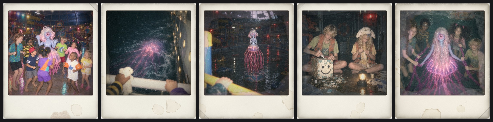

| | Cosa mostra | Quando | Dove sta | Perché lì | Come si trova |
|---|---|---|---|---|---|
| **P12** "L'ultima sera" | La festa della sera sotto la cupola: gli otto bambini ballano in cerchio attorno a un animatore vestito da Jilly, di peluche, con le luci colorate. Dietro la cupola, sul mare nero, un lampo lontano: il temporale arriva. | Prima del naufragio | **Torre degli scivoli**, in cima: per terra nell'angolo del pianerottolo del portone | La torre era il posto dei bambini. L'hanno lasciata in cima, prima di scendere | Entrando dal portone si va verso nord, al primo scivolo, e l'angolo resta alle spalle: la vede chi si guarda intorno prima di buttarsi |
| **P13** "Qualcosa nel mare" | La stessa notte, dal ponte: due mani di bambino sulla ringhiera bagnata, una stringe l'agnellino di peluche. Giù, nel mare nero accanto allo scafo, un enorme bagliore rosa sott'acqua con delle scie come tentacoli. | La notte del naufragio | **Risalita**, il corridoio buio verso il fiume: per terra contro il muro, sotto l'oblò dove compare lei | Sotto l'oblò da cui si vede l'acqua, e da cui lei guarda | Quando ti avvicini per raccoglierla, lei si stacca dal vetro |
| **P14** "La mattina dopo" | La sala allagata all'alba, vista dall'alto della struttura di gioco, con una manina sulla ringhiera gialla. La statua sul piedistallo è bagnata fradicia, con una scia di melma rosa che sale dall'acqua e dei pesciolini ai suoi piedi, come un'offerta. Non si vede chi è stato. | Il primo giorno dopo | **Sala principale**, agli acquari: per terra davanti all'acquario giallo, sotto il disegno a pastello dei bambini | È l'angolo dei bambini: lì c'è il loro disegno, e la foto l'hanno lasciata con lui | Chi si avvicina al disegno, l'indizio dell'enigma, la vede ai piedi della base |
| **P15** "Le maschere" | Anni dopo, in un ripostiglio con una lanterna da campeggio. Il ragazzo biondo incolla piastrelle crepate su una scatola con una faccina disegnata: è il bambino col cubo. La bambina riccia ha in testa l'agnellino di peluche col fiocco alla marinara: è l'agnellino. | Anni dopo | **Risalita**, la zona del personale fra il capannone e l'infermeria: per terra nell'angolo accanto alla porta del capannone | Nella zona del personale c'erano attrezzi e materiali: lì si facevano le maschere | Sta alle spalle di chi entra dal capannone: si vede girandosi, o uscendo dall'infermeria |
| **P16** "Sott'acqua con lei" | Anni dopo, una foto sott'acqua: lei al centro, con la campana che illumina l'acqua di rosa e i capelli lunghissimi. Quattro dei bambini, più grandi, nuotano calmi attorno a lei tenendosi ai tentacoli, a occhi aperti. Guarda l'obiettivo solo lei. | Anni dopo | **Fiume lento**, all'approdo: nell'angolo fra i detriti e il muro, accanto alla porta del personale | Il fiume era il posto dove nuotavano: la foto sta dove si esce dall'acqua | Uscendo dalla ciambella si va verso la porta del personale, e l'angolo è lì accanto, un po' fuori strada |

Insieme alle 11 di prima riempiono dei buchi:
- prima del naufragio la festa e, quella notte, qualcosa nel mare (P10 mostra la stessa forma sotto lo scafo);
- dopo, la statua bagnata la prima mattina, prima del piedistallo vuoto della P7;
- anni dopo, da dove vengono il bambino col cubo e l'agnellino, e lei che insegna a stare sott'acqua.

Non dicono come lei è diventata viva, né perché.

## Gli scatti dal motore

Per ognuna c'è uno scatto nel suo posto, dagli occhi del giocatore, e uno da vicino. Li fa `godot/tests/scatti_polaroid_nuove.gd`. Le luci sono quelle del momento in cui ci si arriva, cioè il blackout con le luci rosse d'emergenza. La sala intera su llvmpipe non ci sta più in memoria: la P14 è scattata nella sala principale ridotta (`tests/scena_ridotta.gd`, preset medio), senza gli interni, gli ambienti tecnici, la risalita, la torre degli scivoli esterna, l'area bimbi, i dettagli e la vasca di lei, con gli acquari pieni come al ritorno dal magazzino.

| | Nel suo posto | Da vicino |
|---|---|---|
| P12 | 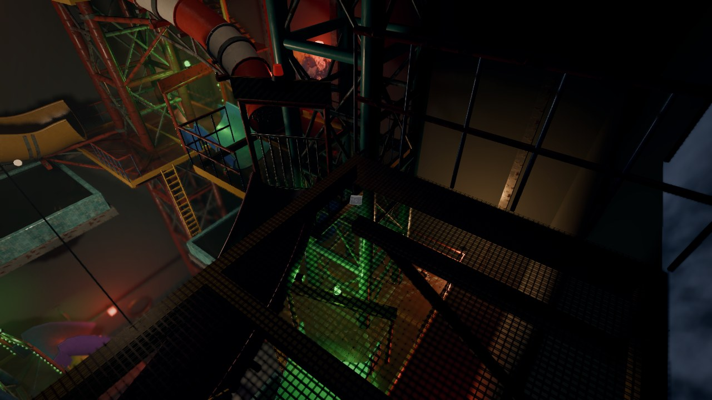 | 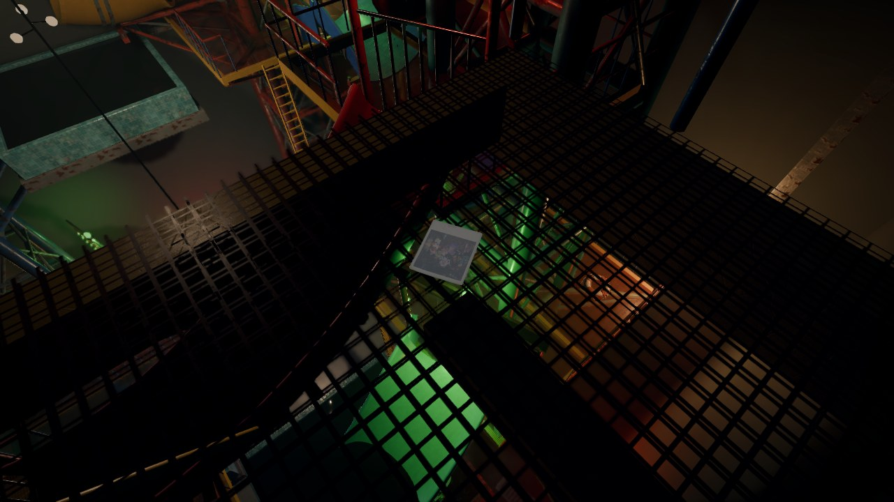 |
| P13 | 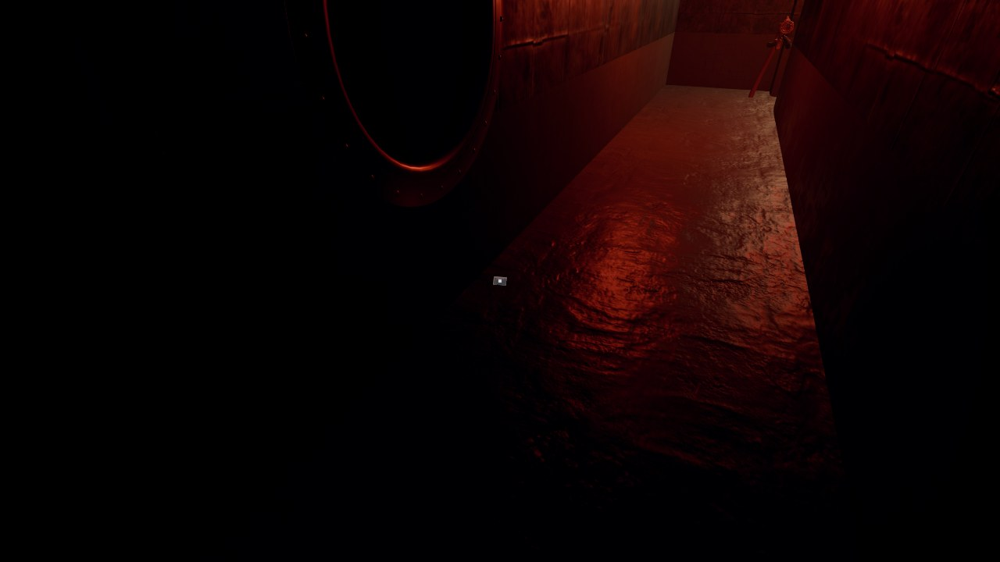 | 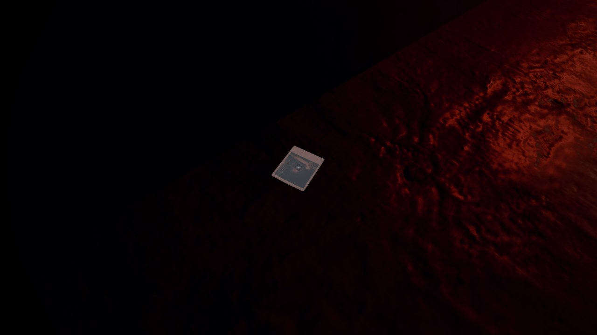 |
| P14 | 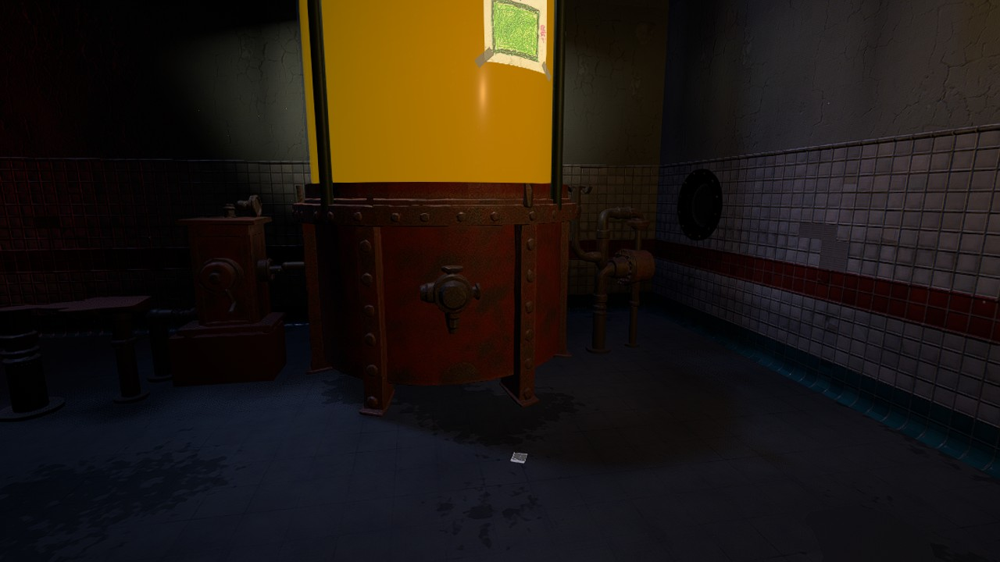 | 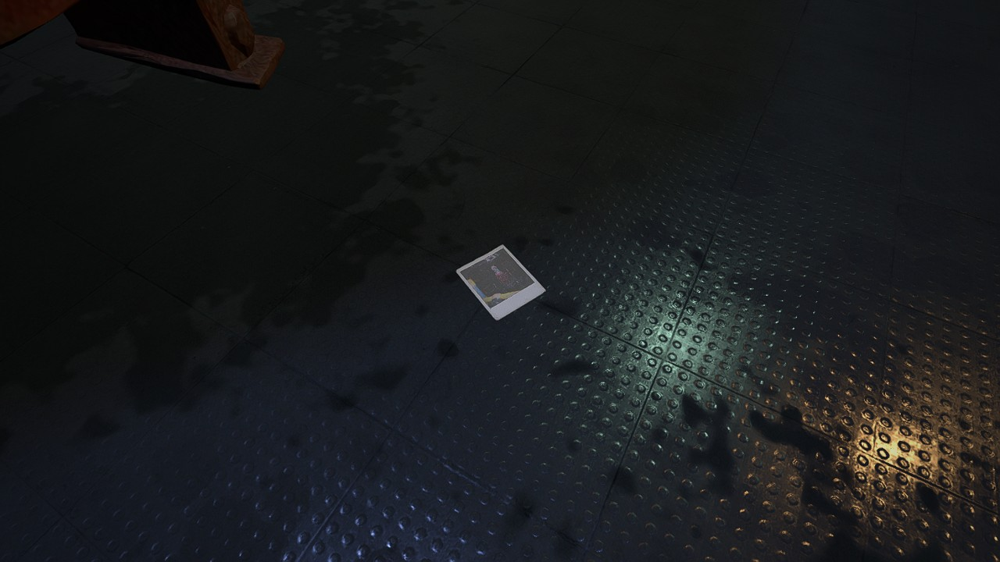 |
| P15 | 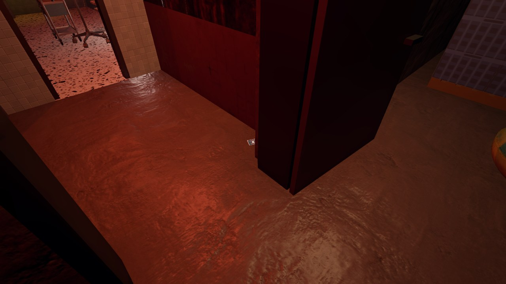 | 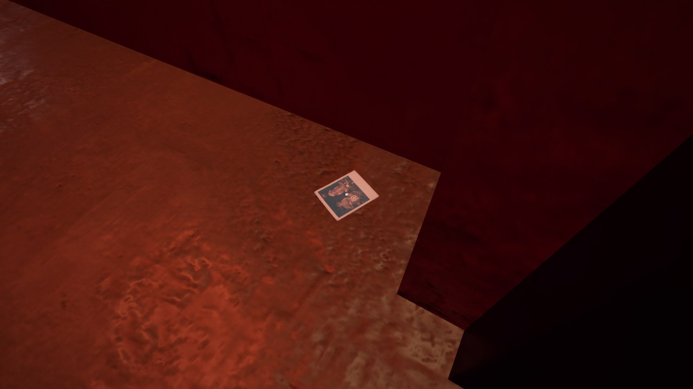 |
| P16 | 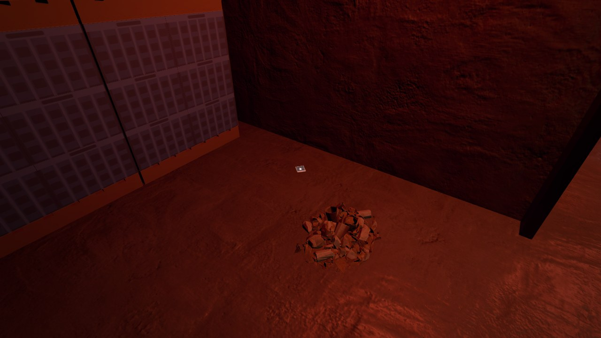 | 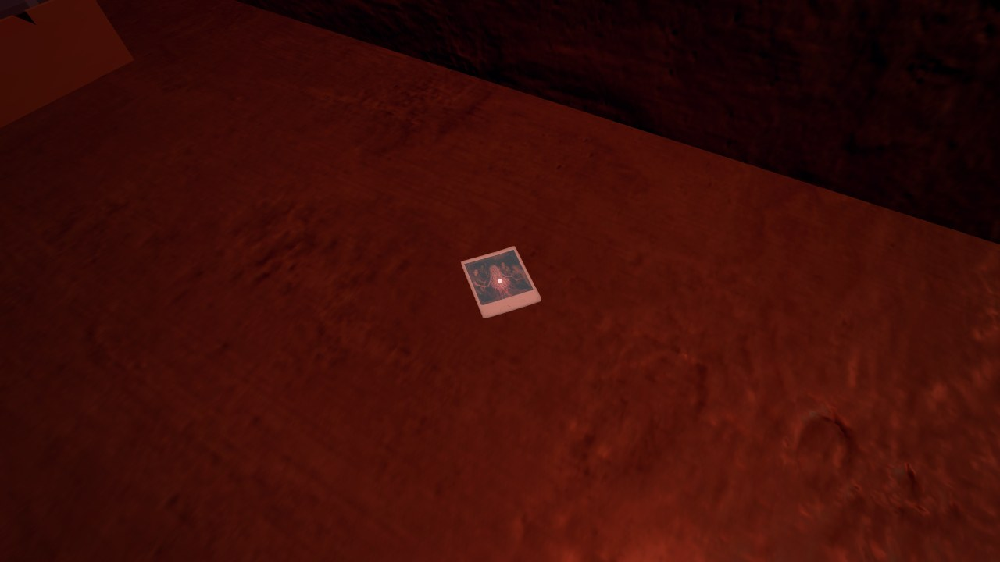 |

## Controlli

- Posizionamento in locale (`tests/controllo_posizionamento.gd`): sala principale, con la risalita e gli acquari in tutti gli stati, e sala della torre. 0 casi nuovi e 0 da correggere.
- Test in locale, tutti verdi: `test_sala` 104/104 (10 Polaroid nella sala, appoggiate, e il totale), `test_risalita_tardi` 12/12 (14 nel totale all'avvio; la P16 appoggiata uguale anche col fiume caricato a gioco avviato), `test_risalita` 13/13 (P13, P15 e P16 ci sono e sono appoggiate), `test_torre` 94/94 (P12 c'è ed è appoggiata), `check_scripts` senza errori.
- Il percorso delle partenze del menu di prova (`assets/prova/*.json`) non è rifatto: chi parte dalla torre o dal tunnel non ha le Polaroid nuove fra quelle raccolte. Si rifà con `tests/genera_partenze_prova.gd` quando l'utente approva.

## Da decidere con l'utente

1. Le cinque foto: vanno bene, o qualcuna si cambia?
2. I posti: vanno bene?
3. La P14 rifatta per la regola "non si vede mai il mostro che prende la bambola": va bene così?
